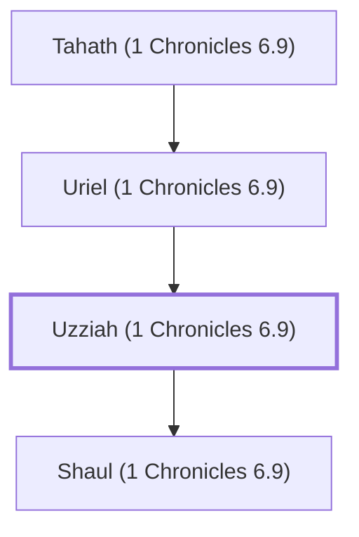

# Uzziah (1 Chronicles 6.9)

Levite musician in the time of David

**Also called:** Azariah

**Original-language names:** עֻזִּיָּהוּ (H5818) · עֲזַרְיָ֫הוּ (H5838)

## When

- **Placed around:** [[connections/timeline/11th century BC|1042 BC]] *(Ussher: the median date of the passages naming them)*

## Family

- **Father:** [[connections/people/Uriel (1 Chronicles 6.9)|Uriel (1 Chronicles 6.9)]]
- **Children:** [[connections/people/Shaul (1 Chronicles 6.9)|Shaul (1 Chronicles 6.9)]]
- **Tribe or nation:** Tribe of Levi

**Line of descent** (32 generations, father to son): [[connections/people/Adam|Adam]] → [[connections/people/Seth|Seth]] → [[connections/people/Enosh|Enosh]] → [[connections/people/Kenan|Kenan]] → [[connections/people/Mahalalel (Genesis 5.12)|Mahalalel (Genesis 5.12)]] → [[connections/people/Jared|Jared]] → [[connections/people/Enoch (Genesis 5.18)|Enoch (Genesis 5.18)]] → [[connections/people/Methuselah|Methuselah]] → [[connections/people/Lamech (Genesis 5.25)|Lamech (Genesis 5.25)]] → [[connections/people/Noah (Genesis 5.29)|Noah (Genesis 5.29)]] → [[connections/people/Shem|Shem]] → [[connections/people/Arpachshad|Arpachshad]] → [[connections/people/Cainan|Cainan]] → [[connections/people/Shelah (Genesis 10.24)|Shelah (Genesis 10.24)]] → [[connections/people/Eber (Genesis 10.21)|Eber (Genesis 10.21)]] → [[connections/people/Peleg|Peleg]] → [[connections/people/Reu|Reu]] → [[connections/people/Serug|Serug]] → [[connections/people/Nahor (Genesis 11.22)|Nahor (Genesis 11.22)]] → [[connections/people/Terah|Terah]] → [[connections/people/Abraham|Abraham]] → [[connections/people/Isaac|Isaac]] → [[connections/people/Israel|Israel]] → [[connections/people/Levi (Genesis 29.34)|Levi (Genesis 29.34)]] → [[connections/people/Kohath|Kohath]] → [[connections/people/Izhar (Exodus 6.18)|Izhar (Exodus 6.18)]] → [[connections/people/Korah (Exodus 6.21)|Korah (Exodus 6.21)]] → [[connections/people/Ebiasaph|Ebiasaph]] → [[connections/people/Assir (1 Chronicles 6.8)|Assir (1 Chronicles 6.8)]] → [[connections/people/Tahath (1 Chronicles 6.9)|Tahath (1 Chronicles 6.9)]] → [[connections/people/Uriel (1 Chronicles 6.9)|Uriel (1 Chronicles 6.9)]] → **Uzziah (1 Chronicles 6.9)**

**Family group:** [[connections/genealogy/Family of Adam|Family of Adam]], generation 32

## Appears in

[[connections/chapters/13-1-chronicles/1 Chronicles 6|1 Chronicles 6 (2)]]

## Appears in the same verse as

[[connections/people/Shaul (1 Chronicles 6.9)|Shaul (1 Chronicles 6.9) (2)]] · [[connections/people/Uriel (1 Chronicles 6.9)|Uriel (1 Chronicles 6.9) (2)]] · [[connections/people/Elkanah (1 Chronicles 6.10)|Elkanah (1 Chronicles 6.10)]] · [[connections/people/Tahath (1 Chronicles 6.9)|Tahath (1 Chronicles 6.9)]]
