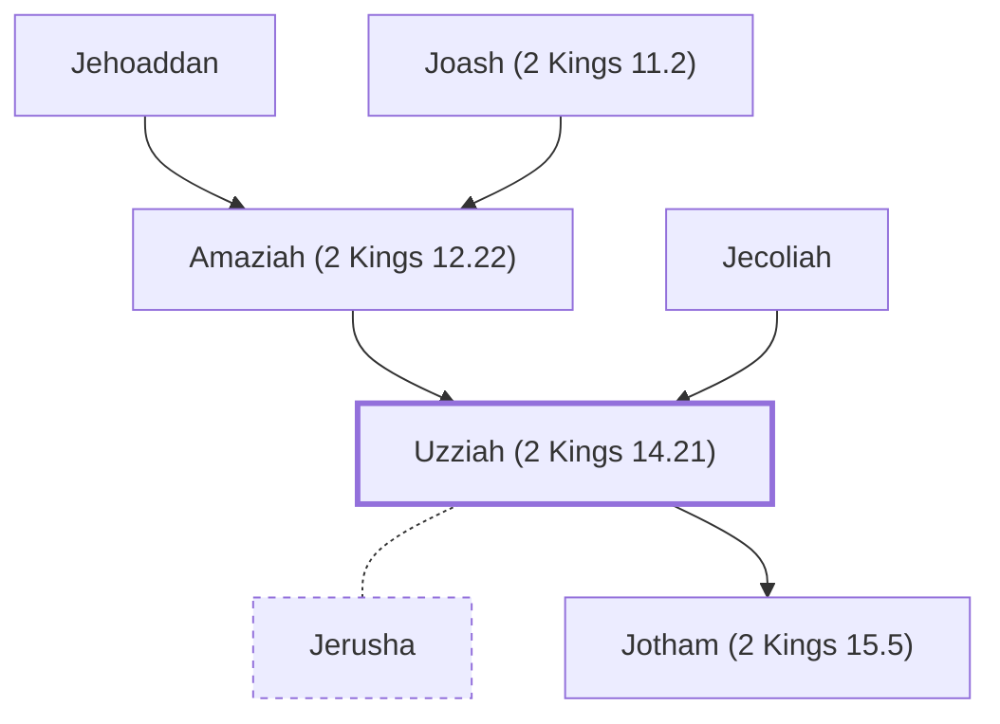

# Uzziah (2 Kings 14.21)

King of Judah, reigned 52 years

**Also called:** Azariah

**Original-language names:** עֻזִּיָּהוּ (H5818) · עֲזַרְיָה (H5838) · עֲזַרְיָ֫הוּ (H5838) · Ὀζίας (G3604)

## When

- **Lived:** [[connections/timeline/9th century BC|827 BC]] – [[connections/timeline/8th century BC|758 BC]] *(Jones)*
- **Placed around:** [[connections/timeline/8th century BC|765 BC]] *(Ussher: the median date of the passages naming them)*

## Family

- **Father:** [[connections/people/Amaziah (2 Kings 12.22)|Amaziah (2 Kings 12.22)]]
- **Mother:** [[connections/people/Jecoliah|Jecoliah]]
- **Spouses:** [[connections/people/Jerusha|Jerusha]]
- **Children:** [[connections/people/Jotham (2 Kings 15.5)|Jotham (2 Kings 15.5)]]
- **Tribe or nation:** Tribe of Judah

**Line of descent** (44 generations, father to son): [[connections/people/Adam|Adam]] → [[connections/people/Seth|Seth]] → [[connections/people/Enosh|Enosh]] → [[connections/people/Kenan|Kenan]] → [[connections/people/Mahalalel (Genesis 5.12)|Mahalalel (Genesis 5.12)]] → [[connections/people/Jared|Jared]] → [[connections/people/Enoch (Genesis 5.18)|Enoch (Genesis 5.18)]] → [[connections/people/Methuselah|Methuselah]] → [[connections/people/Lamech (Genesis 5.25)|Lamech (Genesis 5.25)]] → [[connections/people/Noah (Genesis 5.29)|Noah (Genesis 5.29)]] → [[connections/people/Shem|Shem]] → [[connections/people/Arpachshad|Arpachshad]] → [[connections/people/Cainan|Cainan]] → [[connections/people/Shelah (Genesis 10.24)|Shelah (Genesis 10.24)]] → [[connections/people/Eber (Genesis 10.21)|Eber (Genesis 10.21)]] → [[connections/people/Peleg|Peleg]] → [[connections/people/Reu|Reu]] → [[connections/people/Serug|Serug]] → [[connections/people/Nahor (Genesis 11.22)|Nahor (Genesis 11.22)]] → [[connections/people/Terah|Terah]] → [[connections/people/Abraham|Abraham]] → [[connections/people/Isaac|Isaac]] → [[connections/people/Israel|Israel]] → [[connections/people/Judah (Genesis 29.35)|Judah (Genesis 29.35)]] → [[connections/people/Perez|Perez]] → [[connections/people/Hezron (Genesis 46.12)|Hezron (Genesis 46.12)]] → [[connections/people/Ram (Ruth 4.19)|Ram (Ruth 4.19)]] → [[connections/people/Amminadab (Exodus 6.23)|Amminadab (Exodus 6.23)]] → [[connections/people/Nahshon|Nahshon]] → [[connections/people/Salmon|Salmon]] → [[connections/people/Boaz|Boaz]] → [[connections/people/Obed (Ruth 4.17)|Obed (Ruth 4.17)]] → [[connections/people/Jesse|Jesse]] → [[connections/people/David|David]] → [[connections/people/Solomon|Solomon]] → [[connections/people/Rehoboam|Rehoboam]] → [[connections/people/Abijah (1 Kings 14.31)|Abijah (1 Kings 14.31)]] → [[connections/people/Asa (1 Kings 15.8)|Asa (1 Kings 15.8)]] → [[connections/people/Jehoshaphat (1 Kings 15.24)|Jehoshaphat (1 Kings 15.24)]] → [[connections/people/Jehoram (1 Kings 22.51)|Jehoram (1 Kings 22.51)]] → [[connections/people/Ahaziah (2 Kings 8.24)|Ahaziah (2 Kings 8.24)]] → [[connections/people/Joash (2 Kings 11.2)|Joash (2 Kings 11.2)]] → [[connections/people/Amaziah (2 Kings 12.22)|Amaziah (2 Kings 12.22)]] → **Uzziah (2 Kings 14.21)**

**Family group:** [[connections/genealogy/Family of Adam|Family of Adam]], generation 44

## Events

- [[connections/timeline/9th century BC|810 BC]] · [[connections/events/Reign of Uzziah|Reign of Uzziah]]
- [[connections/timeline/8th century BC|758 BC]] · [[connections/events/Death of Uzziah|Death of Uzziah]]

## Appears in

[[connections/chapters/12-2-kings/2 Kings 14|2 Kings 14]] · [[connections/chapters/12-2-kings/2 Kings 15|2 Kings 15 (11)]] · [[connections/chapters/13-1-chronicles/1 Chronicles 3|1 Chronicles 3]] · [[connections/chapters/14-2-chronicles/2 Chronicles 26|2 Chronicles 26 (11)]] · [[connections/chapters/14-2-chronicles/2 Chronicles 27|2 Chronicles 27]] · [[connections/chapters/23-isaiah/Isaiah 1|Isaiah 1]] · [[connections/chapters/23-isaiah/Isaiah 6|Isaiah 6]] · [[connections/chapters/23-isaiah/Isaiah 7|Isaiah 7]] · [[connections/chapters/28-hosea/Hosea 1|Hosea 1]] · [[connections/chapters/30-amos/Amos 1|Amos 1]] · [[connections/chapters/38-zechariah/Zechariah 14|Zechariah 14]] · [[connections/chapters/40-matthew/Matthew 1|Matthew 1 (2)]]

## Appears in the same verse as

[[connections/people/Judah (Genesis 29.35)|Judah (Genesis 29.35) (15)]] · [[connections/people/Jotham (2 Kings 15.5)|Jotham (2 Kings 15.5) (10)]] · [[connections/people/Israel|Israel (9)]] · [[connections/places/Samaria|Samaria (5)]] · [[connections/people/Ahaz (2 Kings 15.38)|Ahaz (2 Kings 15.38) (4)]] · [[connections/people/Amaziah (2 Kings 12.22)|Amaziah (2 Kings 12.22) (4)]] · [[connections/people/Jeroboam (2 Kings 13.13)|Jeroboam (2 Kings 13.13) (4)]] · [[connections/people/Pekah|Pekah (4)]] · [[connections/people/Remaliah|Remaliah (4)]] · [[connections/places/Jerusalem|Jerusalem (4)]] · [[connections/people/Hezekiah (2 Kings 16.20)|Hezekiah (2 Kings 16.20) (3)]] · [[connections/people/Amoz|Amoz (2)]] · [[connections/people/Isaiah|Isaiah (2)]] · [[connections/people/Joash (2 Kings 13.9)|Joash (2 Kings 13.9) (2)]] · [[connections/people/Menahem|Menahem (2)]] · [[connections/people/Aaron|Aaron]] · [[connections/people/Amos (Amos 1.1)|Amos (Amos 1.1)]] · [[connections/people/Asa (1 Kings 15.8)|Asa (1 Kings 15.8)]] · [[connections/people/Beeri (Hosea 1.1)|Beeri (Hosea 1.1)]] · [[connections/people/David|David]] · [[connections/people/Elah (2 Kings 15.30)|Elah (2 Kings 15.30)]] · [[connections/people/Gadi|Gadi]] · [[connections/people/Hananiah (2 Chronicles 26.11)|Hananiah (2 Chronicles 26.11)]] · [[connections/people/Hosea|Hosea]] · [[connections/people/Hoshea (2 Kings 15.30)|Hoshea (2 Kings 15.30)]] · [[connections/people/Jabesh|Jabesh]] · [[connections/people/Jecoliah|Jecoliah]] · [[connections/people/Jehoram (1 Kings 22.51)|Jehoram (1 Kings 22.51)]] · [[connections/people/Jehoshaphat (1 Kings 15.24)|Jehoshaphat (1 Kings 15.24)]] · [[connections/people/Jeiel (2 Chronicles 26.11)|Jeiel (2 Chronicles 26.11)]] · [[connections/people/Maaseiah (2 Chronicles 26.11)|Maaseiah (2 Chronicles 26.11)]] · [[connections/people/Pekahiah|Pekahiah]] · [[connections/people/Rezin (2 Kings 15.37)|Rezin (2 Kings 15.37)]] · [[connections/people/Shallum (2 Kings 15.10)|Shallum (2 Kings 15.10)]] · [[connections/people/Zechariah (2 Kings 14.29)|Zechariah (2 Kings 14.29)]] · [[connections/places/Angle|Angle]] · [[connections/places/Azal|Azal]] · [[connections/places/Corner Gate|Corner Gate]] · [[connections/places/Egypt|Egypt]] · [[connections/places/Syria|Syria]] · [[connections/places/Tekoa|Tekoa]] · [[connections/places/Valley Gate|Valley Gate]]
