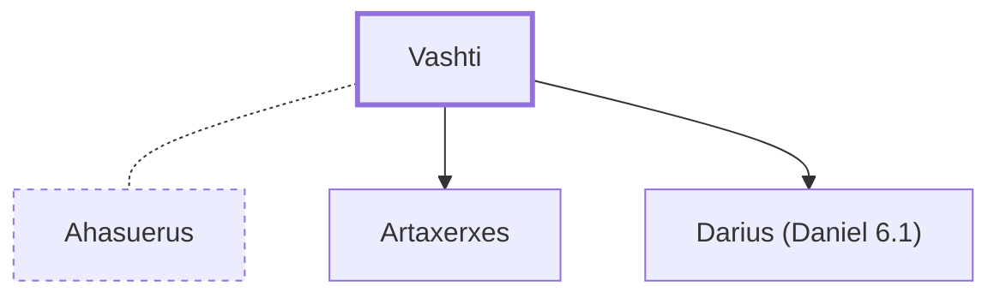

# Vashti

Queen of Persia, deposed by King Ahasuerus (Xerxes)

**Original-language names:** וַשְׁתִּי (H2060)

## When

- **Placed around:** [[connections/timeline/5th century BC|462 BC]] *(Ussher: the median date of the passages naming them)*

## Family

- **Spouses:** [[connections/people/Ahasuerus|Ahasuerus]]
- **Children:** [[connections/people/Artaxerxes|Artaxerxes]], [[connections/people/Darius (Daniel 6.1)|Darius (Daniel 6.1)]]

**Family group:** [[connections/genealogy/Family of Darius (Ezra 4.5)|Family of Darius (Ezra 4.5)]], generation 2

## Appears in

[[connections/chapters/17-esther/Esther 1|Esther 1 (7)]] · [[connections/chapters/17-esther/Esther 2|Esther 2 (3)]]

## Appears in the same verse as

[[connections/people/Ahasuerus|Ahasuerus (6)]] · [[connections/people/Esther|Esther]] · [[connections/people/Memucan|Memucan]] · [[connections/places/Persia|Persia]]
