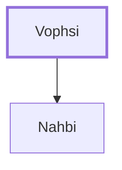

# Vophsi

Father of Nahbi, the Naphtalite spy

**Original-language names:** וׇפְסִי (H2058)

## When

- **Placed around:** [[connections/timeline/15th century BC|1490 BC]] *(Ussher: the median date of the passages naming them)*

## Family

- **Children:** [[connections/people/Nahbi|Nahbi]]

**Family group:** [[connections/genealogy/Family of Vophsi|Family of Vophsi]], generation 1

## Appears in

[[connections/chapters/04-numbers/Numbers 13|Numbers 13]]

## Appears in the same verse as

[[connections/people/Nahbi|Nahbi]] · [[connections/people/Naphtali|Naphtali]]
