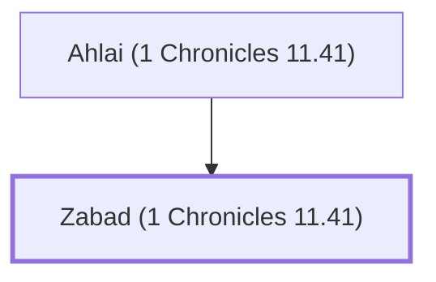

# Zabad (1 Chronicles 11.41)

One of David's mighty warriors

**Original-language names:** זָבָד (H2066)

## When

- **Placed around:** [[connections/timeline/11th century BC|1055 BC]] *(Ussher: the median date of the passages naming them)*

## Family

- **Father:** [[connections/people/Ahlai (1 Chronicles 11.41)|Ahlai (1 Chronicles 11.41)]]

**Family group:** [[connections/genealogy/Family of Ahlai (1 Chronicles 11.41)|Family of Ahlai (1 Chronicles 11.41)]], generation 2

## Appears in

[[connections/chapters/13-1-chronicles/1 Chronicles 11|1 Chronicles 11]]

## Appears in the same verse as

[[connections/people/Ahlai (1 Chronicles 11.41)|Ahlai (1 Chronicles 11.41)]] · [[connections/people/Uriah (2 Samuel 11.3)|Uriah (2 Samuel 11.3)]]
