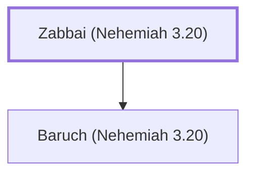

# Zabbai (Nehemiah 3.20)

Repairer of Jerusalem's wall

**Original-language names:** זַבַּי (H2079)

## When

- **Placed around:** [[connections/timeline/5th century BC|445 BC]] *(Ussher: the median date of the passages naming them)*

## Family

- **Children:** [[connections/people/Baruch (Nehemiah 3.20)|Baruch (Nehemiah 3.20)]]

**Family group:** [[connections/genealogy/Family of Zabbai (Nehemiah 3.20)|Family of Zabbai (Nehemiah 3.20)]], generation 1

## Appears in

[[connections/chapters/16-nehemiah/Nehemiah 3|Nehemiah 3]]

## Appears in the same verse as

[[connections/people/Baruch (Nehemiah 3.20)|Baruch (Nehemiah 3.20)]] · [[connections/people/Eliashib (Nehemiah 3.1)|Eliashib (Nehemiah 3.1)]]
