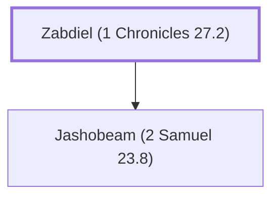

# Zabdiel (1 Chronicles 27.2)

Father of Jashobeam, commander of David's army

**Original-language names:** זַבְדִּיאֵל (H2068)

## When

- **Placed around:** [[connections/timeline/11th century BC|1015 BC]] *(Ussher: the median date of the passages naming them)*

## Family

- **Children:** [[connections/people/Jashobeam (2 Samuel 23.8)|Jashobeam (2 Samuel 23.8)]]

**Family group:** [[connections/genealogy/Family of Zabdiel (1 Chronicles 27.2)|Family of Zabdiel (1 Chronicles 27.2)]], generation 1

## Appears in

[[connections/chapters/13-1-chronicles/1 Chronicles 27|1 Chronicles 27]]

## Appears in the same verse as

[[connections/people/Jashobeam (2 Samuel 23.8)|Jashobeam (2 Samuel 23.8)]]
