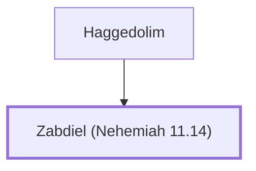

# Zabdiel (Nehemiah 11.14)

Priest and leader in post-exilic Jerusalem

**Original-language names:** זַבְדִּיאֵל (H2068)

## When

- **Placed around:** [[connections/timeline/5th century BC|445 BC]] *(Ussher: the median date of the passages naming them)*

## Family

- **Father:** [[connections/people/Haggedolim|Haggedolim]]

**Family group:** [[connections/genealogy/Family of Haggedolim|Family of Haggedolim]], generation 2

## Appears in

[[connections/chapters/16-nehemiah/Nehemiah 11|Nehemiah 11]]

## Appears in the same verse as

[[connections/people/Haggedolim|Haggedolim]]
