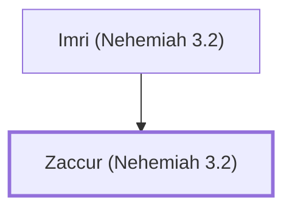

# Zaccur (Nehemiah 3.2)

Son of Imri, helped rebuild Jerusalem's wall

**Original-language names:** זַכּוּר (H2139)

## When

- **Placed around:** [[connections/timeline/5th century BC|445 BC]] *(Ussher: the median date of the passages naming them)*

## Family

- **Father:** [[connections/people/Imri (Nehemiah 3.2)|Imri (Nehemiah 3.2)]]

**Family group:** [[connections/genealogy/Family of Imri (Nehemiah 3.2)|Family of Imri (Nehemiah 3.2)]], generation 2

## Appears in

[[connections/chapters/16-nehemiah/Nehemiah 3|Nehemiah 3]]

## Appears in the same verse as

[[connections/people/Imri (Nehemiah 3.2)|Imri (Nehemiah 3.2)]] · [[connections/places/Jericho|Jericho]]
