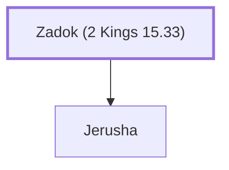

# Zadok (2 Kings 15.33)

Father of Jerusha, wife of King Uzziah

**Original-language names:** צָדוֹק (H6659)

## When

- **Placed around:** [[connections/timeline/8th century BC|753 BC]] *(Ussher: the median date of the passages naming them)*

## Family

- **Children:** [[connections/people/Jerusha|Jerusha]]

**Family group:** [[connections/genealogy/Family of Adam|Family of Adam]], generation 1

## Appears in

[[connections/chapters/12-2-kings/2 Kings 15|2 Kings 15]] · [[connections/chapters/14-2-chronicles/2 Chronicles 27|2 Chronicles 27]]

## Appears in the same verse as

[[connections/people/Jerusha|Jerusha (2)]] · [[connections/places/Jerusalem|Jerusalem (2)]] · [[connections/people/Jotham (2 Kings 15.5)|Jotham (2 Kings 15.5)]]
