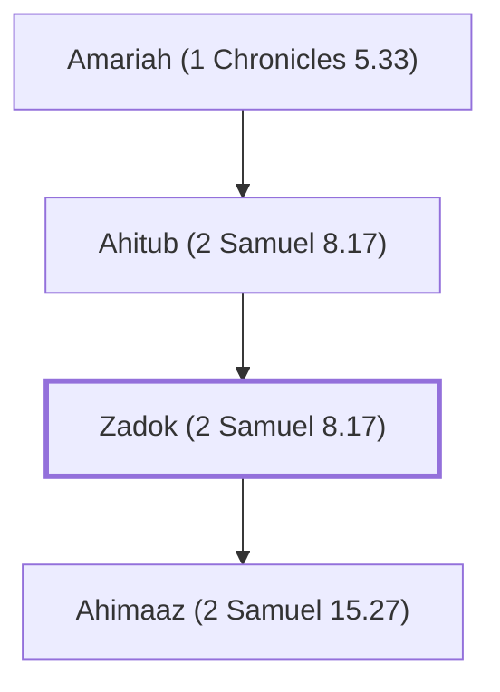

# Zadok (2 Samuel 8.17)

High priest during the reigns of David and Solomon

**Original-language names:** צָדוֹק (H6659)

## When

- **Placed around:** [[connections/timeline/11th century BC|1015 BC]] *(Ussher: the median date of the passages naming them)*

## Family

- **Father:** [[connections/people/Ahitub (2 Samuel 8.17)|Ahitub (2 Samuel 8.17)]]
- **Children:** [[connections/people/Ahimaaz (2 Samuel 15.27)|Ahimaaz (2 Samuel 15.27)]]
- **Tribe or nation:** Tribe of Levi

**Line of descent** (37 generations, father to son): [[connections/people/Adam|Adam]] → [[connections/people/Seth|Seth]] → [[connections/people/Enosh|Enosh]] → [[connections/people/Kenan|Kenan]] → [[connections/people/Mahalalel (Genesis 5.12)|Mahalalel (Genesis 5.12)]] → [[connections/people/Jared|Jared]] → [[connections/people/Enoch (Genesis 5.18)|Enoch (Genesis 5.18)]] → [[connections/people/Methuselah|Methuselah]] → [[connections/people/Lamech (Genesis 5.25)|Lamech (Genesis 5.25)]] → [[connections/people/Noah (Genesis 5.29)|Noah (Genesis 5.29)]] → [[connections/people/Shem|Shem]] → [[connections/people/Arpachshad|Arpachshad]] → [[connections/people/Cainan|Cainan]] → [[connections/people/Shelah (Genesis 10.24)|Shelah (Genesis 10.24)]] → [[connections/people/Eber (Genesis 10.21)|Eber (Genesis 10.21)]] → [[connections/people/Peleg|Peleg]] → [[connections/people/Reu|Reu]] → [[connections/people/Serug|Serug]] → [[connections/people/Nahor (Genesis 11.22)|Nahor (Genesis 11.22)]] → [[connections/people/Terah|Terah]] → [[connections/people/Abraham|Abraham]] → [[connections/people/Isaac|Isaac]] → [[connections/people/Israel|Israel]] → [[connections/people/Levi (Genesis 29.34)|Levi (Genesis 29.34)]] → [[connections/people/Kohath|Kohath]] → [[connections/people/Amram (Exodus 6.18)|Amram (Exodus 6.18)]] → [[connections/people/Aaron|Aaron]] → [[connections/people/Eleazar (Exodus 6.23)|Eleazar (Exodus 6.23)]] → [[connections/people/Phinehas (Exodus 6.25)|Phinehas (Exodus 6.25)]] → [[connections/people/Abishua (1 Chronicles 5.30)|Abishua (1 Chronicles 5.30)]] → [[connections/people/Bukki (1 Chronicles 5.31)|Bukki (1 Chronicles 5.31)]] → [[connections/people/Uzzi (1 Chronicles 5.31)|Uzzi (1 Chronicles 5.31)]] → [[connections/people/Zerahiah (1 Chronicles 5.32)|Zerahiah (1 Chronicles 5.32)]] → [[connections/people/Meraioth|Meraioth]] → [[connections/people/Amariah (1 Chronicles 5.33)|Amariah (1 Chronicles 5.33)]] → [[connections/people/Ahitub (2 Samuel 8.17)|Ahitub (2 Samuel 8.17)]] → **Zadok (2 Samuel 8.17)**

**Family group:** [[connections/genealogy/Family of Adam|Family of Adam]], generation 37

## Appears in

[[connections/chapters/10-2-samuel/2 Samuel 8|2 Samuel 8]] · [[connections/chapters/10-2-samuel/2 Samuel 15|2 Samuel 15 (6)]] · [[connections/chapters/10-2-samuel/2 Samuel 17|2 Samuel 17]] · [[connections/chapters/10-2-samuel/2 Samuel 18|2 Samuel 18 (3)]] · [[connections/chapters/10-2-samuel/2 Samuel 19|2 Samuel 19]] · [[connections/chapters/10-2-samuel/2 Samuel 20|2 Samuel 20]] · [[connections/chapters/11-1-kings/1 Kings 1|1 Kings 1 (8)]] · [[connections/chapters/11-1-kings/1 Kings 2|1 Kings 2]] · [[connections/chapters/11-1-kings/1 Kings 4|1 Kings 4 (2)]] · [[connections/chapters/13-1-chronicles/1 Chronicles 5|1 Chronicles 5]] · [[connections/chapters/13-1-chronicles/1 Chronicles 6|1 Chronicles 6]] · [[connections/chapters/13-1-chronicles/1 Chronicles 12|1 Chronicles 12]] · [[connections/chapters/13-1-chronicles/1 Chronicles 15|1 Chronicles 15]] · [[connections/chapters/13-1-chronicles/1 Chronicles 16|1 Chronicles 16]] · [[connections/chapters/13-1-chronicles/1 Chronicles 18|1 Chronicles 18]] · [[connections/chapters/13-1-chronicles/1 Chronicles 24|1 Chronicles 24 (3)]] · [[connections/chapters/13-1-chronicles/1 Chronicles 27|1 Chronicles 27]] · [[connections/chapters/13-1-chronicles/1 Chronicles 29|1 Chronicles 29]] · [[connections/chapters/14-2-chronicles/2 Chronicles 31|2 Chronicles 31]] · [[connections/chapters/26-ezekiel/Ezekiel 40|Ezekiel 40]] · [[connections/chapters/26-ezekiel/Ezekiel 43|Ezekiel 43]] · [[connections/chapters/26-ezekiel/Ezekiel 44|Ezekiel 44]] · [[connections/chapters/26-ezekiel/Ezekiel 48|Ezekiel 48]]

## Appears in the same verse as

[[connections/people/Abiathar|Abiathar (14)]] · [[connections/people/David|David (8)]] · [[connections/people/Ahimaaz (2 Samuel 15.27)|Ahimaaz (2 Samuel 15.27) (7)]] · [[connections/people/Benaiah (2 Samuel 8.18)|Benaiah (2 Samuel 8.18) (7)]] · [[connections/people/Jehoiada (2 Samuel 8.18)|Jehoiada (2 Samuel 8.18) (7)]] · [[connections/people/Nathan (2 Samuel 7.2)|Nathan (2 Samuel 7.2) (6)]] · [[connections/people/Ahimelech (2 Samuel 8.17)|Ahimelech (2 Samuel 8.17) (5)]] · [[connections/people/Israel|Israel (5)]] · [[connections/people/Solomon|Solomon (5)]] · [[connections/people/Ahitub (2 Samuel 8.17)|Ahitub (2 Samuel 8.17) (3)]] · [[connections/people/Seraiah (2 Samuel 8.17)|Seraiah (2 Samuel 8.17) (3)]] · [[connections/people/Aaron|Aaron (2)]] · [[connections/people/Eleazar (Exodus 6.23)|Eleazar (Exodus 6.23) (2)]] · [[connections/people/Ithamar|Ithamar (2)]] · [[connections/people/Jonathan (2 Samuel 15.27)|Jonathan (2 Samuel 15.27) (2)]] · [[connections/people/Levi (Genesis 29.34)|Levi (Genesis 29.34) (2)]] · [[connections/places/Gihon|Gihon (2)]] · [[connections/people/Absalom|Absalom]] · [[connections/people/Adonijah (2 Samuel 3.4)|Adonijah (2 Samuel 3.4)]] · [[connections/people/Ahithophel|Ahithophel]] · [[connections/people/Amminadab (1 Chronicles 15.10)|Amminadab (1 Chronicles 15.10)]] · [[connections/people/Asaiah (1 Chronicles 15.6)|Asaiah (1 Chronicles 15.6)]] · [[connections/people/Azariah (1 Kings 4.2)|Azariah (1 Kings 4.2)]] · [[connections/people/Azariah (2 Chronicles 31.10)|Azariah (2 Chronicles 31.10)]] · [[connections/people/Eliel (1 Chronicles 15.9)|Eliel (1 Chronicles 15.9)]] · [[connections/people/Hashabiah (1 Chronicles 27.17)|Hashabiah (1 Chronicles 27.17)]] · [[connections/people/Hushai|Hushai]] · [[connections/people/Joab (1 Samuel 26.6)|Joab (1 Samuel 26.6)]] · [[connections/people/Joel (1 Chronicles 15.7)|Joel (1 Chronicles 15.7)]] · [[connections/people/Judah (Genesis 29.35)|Judah (Genesis 29.35)]] · [[connections/people/Kemuel (1 Chronicles 27.17)|Kemuel (1 Chronicles 27.17)]] · [[connections/people/Nethanel (1 Chronicles 24.6)|Nethanel (1 Chronicles 24.6)]] · [[connections/people/Rei|Rei]] · [[connections/people/Shemaiah (1 Chronicles 15.8)|Shemaiah (1 Chronicles 15.8)]] · [[connections/people/Shemaiah (1 Chronicles 24.6)|Shemaiah (1 Chronicles 24.6)]] · [[connections/people/Shimei (1 Kings 1.8)|Shimei (1 Kings 1.8)]] · [[connections/people/Uriel (1 Chronicles 15.5)|Uriel (1 Chronicles 15.5)]] · [[connections/places/Gibeon|Gibeon]] · [[connections/places/Jerusalem|Jerusalem]]
