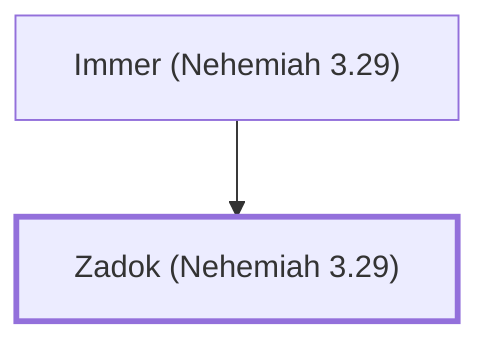

# Zadok (Nehemiah 3.29)

Repaired a section of Jerusalem's wall

**Original-language names:** צָדוֹק (H6659)

## When

- **Placed around:** [[connections/timeline/5th century BC|445 BC]] *(Ussher: the median date of the passages naming them)*

## Family

- **Father:** [[connections/people/Immer (Nehemiah 3.29)|Immer (Nehemiah 3.29)]]

**Family group:** [[connections/genealogy/Family of Immer (Nehemiah 3.29)|Family of Immer (Nehemiah 3.29)]], generation 2

## Appears in

[[connections/chapters/16-nehemiah/Nehemiah 3|Nehemiah 3]]

## Appears in the same verse as

[[connections/people/Immer (Nehemiah 3.29)|Immer (Nehemiah 3.29)]] · [[connections/people/Shecaniah (Ezra 10.2)|Shecaniah (Ezra 10.2)]] · [[connections/people/Shemaiah (Nehemiah 3.29)|Shemaiah (Nehemiah 3.29)]] · [[connections/places/East Gate|East Gate]]
