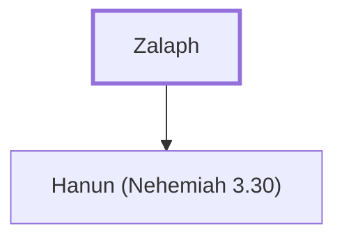

# Zalaph

Father of Hanun, who repaired Jerusalem's wall

**Original-language names:** צָלָף (H6764)

## When

- **Placed around:** [[connections/timeline/5th century BC|445 BC]] *(Ussher: the median date of the passages naming them)*

## Family

- **Children:** [[connections/people/Hanun (Nehemiah 3.30)|Hanun (Nehemiah 3.30)]]

**Family group:** [[connections/genealogy/Family of Zalaph|Family of Zalaph]], generation 1

## Appears in

[[connections/chapters/16-nehemiah/Nehemiah 3|Nehemiah 3]]

## Appears in the same verse as

[[connections/people/Berechiah (Nehemiah 3.4)|Berechiah (Nehemiah 3.4)]] · [[connections/people/Hananiah (Nehemiah 3.30)|Hananiah (Nehemiah 3.30)]] · [[connections/people/Hanun (Nehemiah 3.30)|Hanun (Nehemiah 3.30)]] · [[connections/people/Meshullam (Nehemiah 3.4)|Meshullam (Nehemiah 3.4)]] · [[connections/people/Shelemiah (Nehemiah 3.30)|Shelemiah (Nehemiah 3.30)]]
