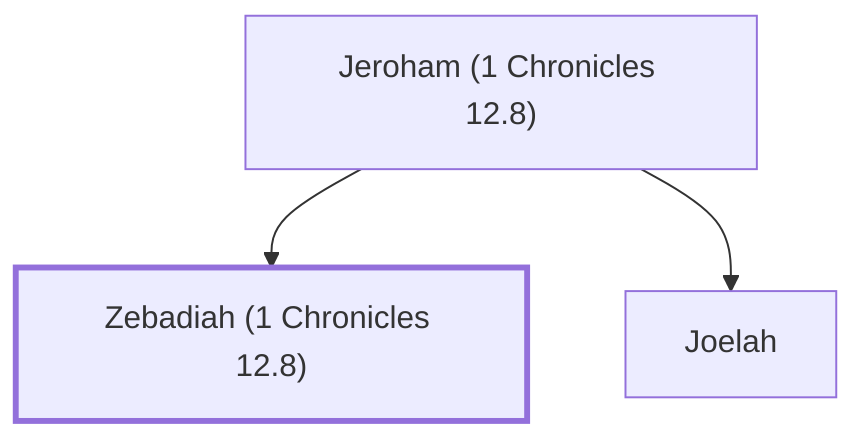

# Zebadiah (1 Chronicles 12.8)

Gadite warrior who joined David

**Original-language names:** זְבַדְיָהוּ (H2069)

## Family

- **Father:** [[connections/people/Jeroham (1 Chronicles 12.8)|Jeroham (1 Chronicles 12.8)]]
- **Brothers and sisters:** [[connections/people/Joelah|Joelah]]

**Family group:** [[connections/genealogy/Family of Jeroham (1 Chronicles 12.8)|Family of Jeroham (1 Chronicles 12.8)]], generation 2

## Appears in

[[connections/chapters/13-1-chronicles/1 Chronicles 12|1 Chronicles 12]]

## Appears in the same verse as

[[connections/people/Jeroham (1 Chronicles 12.8)|Jeroham (1 Chronicles 12.8)]] · [[connections/people/Joelah|Joelah]] · [[connections/places/Gedor (Joshua 12.13)|Gedor (Joshua 12.13)]]
