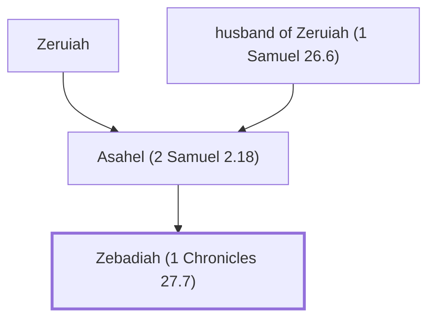

# Zebadiah (1 Chronicles 27.7)

Son of Asahel, commander of David's army

**Original-language names:** זְבַדְיָהוּ (H2069)

## When

- **Placed around:** [[connections/timeline/11th century BC|1015 BC]] *(Ussher: the median date of the passages naming them)*

## Family

- **Father:** [[connections/people/Asahel (2 Samuel 2.18)|Asahel (2 Samuel 2.18)]]
- **Tribe or nation:** Tribe of Judah

**Line of descent** (3 generations, father to son): [[connections/people/husband of Zeruiah (1 Samuel 26.6)|husband of Zeruiah (1 Samuel 26.6)]] → [[connections/people/Asahel (2 Samuel 2.18)|Asahel (2 Samuel 2.18)]] → **Zebadiah (1 Chronicles 27.7)**

**Family group:** [[connections/genealogy/Family of Adam|Family of Adam]], generation 38

## Appears in

[[connections/chapters/13-1-chronicles/1 Chronicles 27|1 Chronicles 27]]

## Appears in the same verse as

[[connections/people/Asahel (2 Samuel 2.18)|Asahel (2 Samuel 2.18)]] · [[connections/people/Joab (1 Samuel 26.6)|Joab (1 Samuel 26.6)]]
