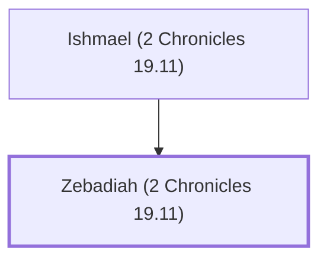

# Zebadiah (2 Chronicles 19.11)

Chief priest in matters of the Lord

**Original-language names:** זְבַדְיָהוּ (H2069)

## When

- **Placed around:** [[connections/timeline/9th century BC|896 BC]] *(Ussher: the median date of the passages naming them)*

## Family

- **Father:** [[connections/people/Ishmael (2 Chronicles 19.11)|Ishmael (2 Chronicles 19.11)]]
- **Tribe or nation:** Tribe of Benjamin

**Family group:** [[connections/genealogy/Family of Ishmael (2 Chronicles 19.11)|Family of Ishmael (2 Chronicles 19.11)]], generation 2

## Appears in

[[connections/chapters/14-2-chronicles/2 Chronicles 19|2 Chronicles 19]]

## Appears in the same verse as

[[connections/people/Amariah (2 Chronicles 19.11)|Amariah (2 Chronicles 19.11)]] · [[connections/people/Ishmael (2 Chronicles 19.11)|Ishmael (2 Chronicles 19.11)]] · [[connections/people/Judah (Genesis 29.35)|Judah (Genesis 29.35)]]
