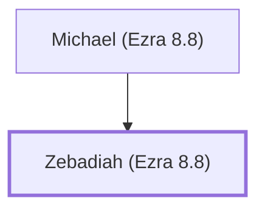

# Zebadiah (Ezra 8.8)

Leader of returning exiles with Shecaniah

**Original-language names:** זְבַדְיָהוּ (H2069)

## When

- **Placed around:** [[connections/timeline/5th century BC|457 BC]] *(Ussher: the median date of the passages naming them)*

## Family

- **Father:** [[connections/people/Michael (Ezra 8.8)|Michael (Ezra 8.8)]]

**Family group:** [[connections/genealogy/Family of Michael (Ezra 8.8)|Family of Michael (Ezra 8.8)]], generation 2

## Appears in

[[connections/chapters/15-ezra/Ezra 8|Ezra 8]]

## Appears in the same verse as

[[connections/people/Michael (Ezra 8.8)|Michael (Ezra 8.8)]] · [[connections/people/Shephatiah (Ezra 2.4)|Shephatiah (Ezra 2.4)]]
