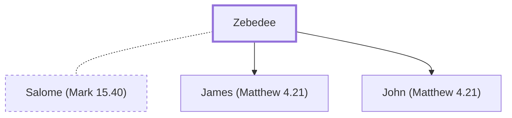

# Zebedee

Father of the apostles James and John

**Original-language names:** Ζεβεδαῖος (G2199)

## When

- **Placed around:** [[connections/timeline/1st century AD|AD 31]] *(Ussher: the median date of the passages naming them)*

## Family

- **Spouses:** [[connections/people/Salome (Mark 15.40)|Salome (Mark 15.40) (uncertain)]]
- **Children:** [[connections/people/James (Matthew 4.21)|James (Matthew 4.21)]], [[connections/people/John (Matthew 4.21)|John (Matthew 4.21)]]

**Family group:** [[connections/genealogy/Family of Adam|Family of Adam]], generation 77

## Events

- [[connections/timeline/1st century AD|AD 27]] · [[connections/events/Fishers of Men|Fishers of Men]]

## Appears in

[[connections/chapters/40-matthew/Matthew 4|Matthew 4]] · [[connections/chapters/40-matthew/Matthew 10|Matthew 10]] · [[connections/chapters/40-matthew/Matthew 20|Matthew 20]] · [[connections/chapters/40-matthew/Matthew 26|Matthew 26]] · [[connections/chapters/40-matthew/Matthew 27|Matthew 27]] · [[connections/chapters/41-mark/Mark 1|Mark 1 (2)]] · [[connections/chapters/41-mark/Mark 3|Mark 3]] · [[connections/chapters/41-mark/Mark 10|Mark 10]] · [[connections/chapters/42-luke/Luke 5|Luke 5]] · [[connections/chapters/43-john/John 21|John 21]]

## Appears in the same verse as

[[connections/people/James (Matthew 4.21)|James (Matthew 4.21) (6)]] · [[connections/people/John (Matthew 4.21)|John (Matthew 4.21) (6)]] · [[connections/people/Peter|Peter (4)]] · [[connections/people/Andrew|Andrew]] · [[connections/people/James (Matthew 10.3)|James (Matthew 10.3)]] · [[connections/people/Jesus|Jesus]] · [[connections/people/Joses (Matthew 27.56)|Joses (Matthew 27.56)]] · [[connections/people/Mary (Matthew 27.56)|Mary (Matthew 27.56)]] · [[connections/people/Mary Magdalene|Mary Magdalene]] · [[connections/people/Nathanael|Nathanael]] · [[connections/people/Thomas|Thomas]] · [[connections/places/Galilee|Galilee]] · [[connections/places/Kanah (Joshua 19.28)|Kanah (Joshua 19.28)]] · [[connections/places/Magadan|Magadan]]
