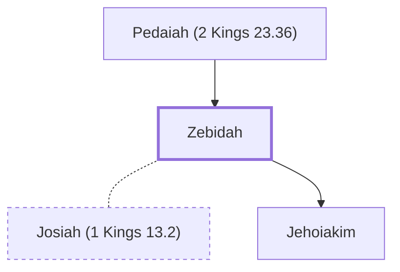

# Zebidah

Mother of King Jehoiakim of Judah

**Original-language names:** זְבוּדָה (H2080)

## When

- **Placed around:** [[connections/timeline/7th century BC|610 BC]] *(Ussher: the median date of the passages naming them)*

## Family

- **Father:** [[connections/people/Pedaiah (2 Kings 23.36)|Pedaiah (2 Kings 23.36)]]
- **Spouses:** [[connections/people/Josiah (1 Kings 13.2)|Josiah (1 Kings 13.2)]]
- **Children:** [[connections/people/Jehoiakim|Jehoiakim]]

**Family group:** [[connections/genealogy/Family of Adam|Family of Adam]], generation 2

## Appears in

[[connections/chapters/12-2-kings/2 Kings 23|2 Kings 23]]

## Appears in the same verse as

[[connections/people/Jehoiakim|Jehoiakim]] · [[connections/people/Pedaiah (2 Kings 23.36)|Pedaiah (2 Kings 23.36)]] · [[connections/places/Arumah|Arumah]] · [[connections/places/Jerusalem|Jerusalem]]
