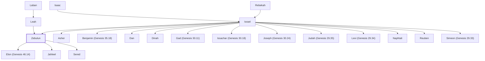

# Zebulun

Israelite tribe, son of Jacob and Leah

**Original-language names:** זְבוּלֻן (H2074) · Ζαβουλών (G2194)

## When

- **Lived:** [[connections/timeline/18th century BC|1751 BC]] – ? *(Jones)*
- **Placed around:** [[connections/timeline/15th century BC|1443 BC]] *(Ussher: the median date of the passages naming them)*

## Family

- **Father:** [[connections/people/Israel|Israel]]
- **Mother:** [[connections/people/Leah|Leah]]
- **Brothers and sisters:** [[connections/people/Asher|Asher]], [[connections/people/Benjamin (Genesis 35.18)|Benjamin (Genesis 35.18)]], [[connections/people/Dan|Dan]], [[connections/people/Dinah|Dinah]], [[connections/people/Gad (Genesis 30.11)|Gad (Genesis 30.11)]], [[connections/people/Issachar (Genesis 30.18)|Issachar (Genesis 30.18)]], [[connections/people/Joseph (Genesis 30.24)|Joseph (Genesis 30.24)]], [[connections/people/Judah (Genesis 29.35)|Judah (Genesis 29.35)]], [[connections/people/Levi (Genesis 29.34)|Levi (Genesis 29.34)]], [[connections/people/Naphtali|Naphtali]], [[connections/people/Reuben|Reuben]], [[connections/people/Simeon (Genesis 29.33)|Simeon (Genesis 29.33)]]
- **Children:** [[connections/people/Elon (Genesis 46.14)|Elon (Genesis 46.14)]], [[connections/people/Jahleel|Jahleel]], [[connections/people/Sered|Sered]]
- **Tribe or nation:** Tribe of Zebulun

**Line of descent** (24 generations, father to son): [[connections/people/Adam|Adam]] → [[connections/people/Seth|Seth]] → [[connections/people/Enosh|Enosh]] → [[connections/people/Kenan|Kenan]] → [[connections/people/Mahalalel (Genesis 5.12)|Mahalalel (Genesis 5.12)]] → [[connections/people/Jared|Jared]] → [[connections/people/Enoch (Genesis 5.18)|Enoch (Genesis 5.18)]] → [[connections/people/Methuselah|Methuselah]] → [[connections/people/Lamech (Genesis 5.25)|Lamech (Genesis 5.25)]] → [[connections/people/Noah (Genesis 5.29)|Noah (Genesis 5.29)]] → [[connections/people/Shem|Shem]] → [[connections/people/Arpachshad|Arpachshad]] → [[connections/people/Cainan|Cainan]] → [[connections/people/Shelah (Genesis 10.24)|Shelah (Genesis 10.24)]] → [[connections/people/Eber (Genesis 10.21)|Eber (Genesis 10.21)]] → [[connections/people/Peleg|Peleg]] → [[connections/people/Reu|Reu]] → [[connections/people/Serug|Serug]] → [[connections/people/Nahor (Genesis 11.22)|Nahor (Genesis 11.22)]] → [[connections/people/Terah|Terah]] → [[connections/people/Abraham|Abraham]] → [[connections/people/Isaac|Isaac]] → [[connections/people/Israel|Israel]] → **Zebulun**

**Family group:** [[connections/genealogy/Family of Adam|Family of Adam]], generation 24

## Events

- [[connections/timeline/18th century BC|1751 BC]] · [[connections/events/Birth of Zebulon|Birth of Zebulon]]
- [[connections/timeline/18th century BC|1728 BC]] · [[connections/events/Joseph sold to Egypt|Joseph sold to Egypt]]
- [[connections/timeline/18th century BC|1708 BC]] · [[connections/events/7 years of famine|7 years of famine]]
- [[connections/timeline/18th century BC|1706 BC]] · [[connections/events/Joseph's brothers return to Egypt|Joseph's brothers return to Egypt]]

## Appears in

[[connections/chapters/01-genesis/Genesis 30|Genesis 30]] · [[connections/chapters/01-genesis/Genesis 35|Genesis 35]] · [[connections/chapters/01-genesis/Genesis 46|Genesis 46]] · [[connections/chapters/01-genesis/Genesis 49|Genesis 49]] · [[connections/chapters/02-exodus/Exodus 1|Exodus 1]] · [[connections/chapters/04-numbers/Numbers 1|Numbers 1 (3)]] · [[connections/chapters/04-numbers/Numbers 2|Numbers 2]] · [[connections/chapters/04-numbers/Numbers 7|Numbers 7]] · [[connections/chapters/04-numbers/Numbers 10|Numbers 10]] · [[connections/chapters/04-numbers/Numbers 13|Numbers 13]] · [[connections/chapters/04-numbers/Numbers 26|Numbers 26]] · [[connections/chapters/04-numbers/Numbers 34|Numbers 34]] · [[connections/chapters/05-deuteronomy/Deuteronomy 27|Deuteronomy 27]] · [[connections/chapters/05-deuteronomy/Deuteronomy 33|Deuteronomy 33]] · [[connections/chapters/06-joshua/Joshua 19|Joshua 19 (4)]] · [[connections/chapters/06-joshua/Joshua 21|Joshua 21 (2)]] · [[connections/chapters/07-judges/Judges 1|Judges 1]] · [[connections/chapters/07-judges/Judges 4|Judges 4 (2)]] · [[connections/chapters/07-judges/Judges 5|Judges 5 (2)]] · [[connections/chapters/07-judges/Judges 6|Judges 6]] · [[connections/chapters/07-judges/Judges 12|Judges 12]] · [[connections/chapters/13-1-chronicles/1 Chronicles 2|1 Chronicles 2]] · [[connections/chapters/13-1-chronicles/1 Chronicles 6|1 Chronicles 6 (2)]] · [[connections/chapters/13-1-chronicles/1 Chronicles 12|1 Chronicles 12 (2)]] · [[connections/chapters/13-1-chronicles/1 Chronicles 27|1 Chronicles 27]] · [[connections/chapters/14-2-chronicles/2 Chronicles 30|2 Chronicles 30 (3)]] · [[connections/chapters/19-psalms/Psalms 68|Psalms 68]] · [[connections/chapters/23-isaiah/Isaiah 8|Isaiah 8]] · [[connections/chapters/26-ezekiel/Ezekiel 48|Ezekiel 48 (3)]] · [[connections/chapters/40-matthew/Matthew 4|Matthew 4 (2)]] · [[connections/chapters/66-revelation/Revelation 7|Revelation 7]]

## Appears in the same verse as

[[connections/people/Naphtali|Naphtali (11)]] · [[connections/people/Issachar (Genesis 30.18)|Issachar (Genesis 30.18) (8)]] · [[connections/people/Reuben|Reuben (5)]] · [[connections/people/Asher|Asher (4)]] · [[connections/people/Benjamin (Genesis 35.18)|Benjamin (Genesis 35.18) (4)]] · [[connections/people/Eliab (Numbers 1.9)|Eliab (Numbers 1.9) (4)]] · [[connections/people/Gad (Genesis 30.11)|Gad (Genesis 30.11) (4)]] · [[connections/people/Helon|Helon (4)]] · [[connections/people/Israel|Israel (4)]] · [[connections/people/Judah (Genesis 29.35)|Judah (Genesis 29.35) (4)]] · [[connections/people/Manasseh (Genesis 41.51)|Manasseh (Genesis 41.51) (4)]] · [[connections/people/Merari|Merari (4)]] · [[connections/people/Ephraim|Ephraim (3)]] · [[connections/people/Simeon (Genesis 29.33)|Simeon (Genesis 29.33) (3)]] · [[connections/places/Jordan|Jordan (3)]] · [[connections/people/Barak|Barak (2)]] · [[connections/people/Elon (Genesis 46.14)|Elon (Genesis 46.14) (2)]] · [[connections/people/Jahleel|Jahleel (2)]] · [[connections/people/Leah|Leah (2)]] · [[connections/people/Levi (Genesis 29.34)|Levi (Genesis 29.34) (2)]] · [[connections/people/Sered|Sered (2)]] · [[connections/places/Galilee|Galilee (2)]] · [[connections/places/Kedesh|Kedesh (2)]] · [[connections/places/Kitron|Kitron (2)]] · [[connections/people/Abinoam|Abinoam]] · [[connections/people/Azriel (1 Chronicles 27.19)|Azriel (1 Chronicles 27.19)]] · [[connections/people/Deborah (Judges 4.4)|Deborah (Judges 4.4)]] · [[connections/people/Elizaphan (Numbers 34.25)|Elizaphan (Numbers 34.25)]] · [[connections/people/Elon (Judges 12.11)|Elon (Judges 12.11)]] · [[connections/people/Gaddiel|Gaddiel]] · [[connections/people/Hezekiah (2 Kings 16.20)|Hezekiah (2 Kings 16.20)]] · [[connections/people/Ishmaiah (1 Chronicles 27.19)|Ishmaiah (1 Chronicles 27.19)]] · [[connections/people/Jerimoth (1 Chronicles 27.19)|Jerimoth (1 Chronicles 27.19)]] · [[connections/people/Joseph (Genesis 30.24)|Joseph (Genesis 30.24)]] · [[connections/people/Machir (Genesis 50.23)|Machir (Genesis 50.23)]] · [[connections/people/Obadiah (1 Chronicles 27.19)|Obadiah (1 Chronicles 27.19)]] · [[connections/people/Parnach|Parnach]] · [[connections/people/Sodi|Sodi]] · [[connections/places/Aijalon|Aijalon]] · [[connections/places/Amalek|Amalek]] · [[connections/places/Aznoth-tabor|Aznoth-tabor]] · [[connections/places/Beth-dagon (Joshua 19.27)|Beth-dagon (Joshua 19.27)]] · [[connections/places/Beth-emek|Beth-emek]] · [[connections/places/Cabul (Joshua 19.27)|Cabul (Joshua 19.27)]] · [[connections/places/Capernaum|Capernaum]] · [[connections/places/Chesulloth|Chesulloth]] · [[connections/places/Dan|Dan]] · [[connections/places/Dimnah|Dimnah]] · [[connections/places/Ebal Mount|Ebal Mount]] · [[connections/places/Hukkok|Hukkok]] · [[connections/places/Iphtahel Valley|Iphtahel Valley]] · [[connections/places/Jerusalem|Jerusalem]] · [[connections/places/Jokneam|Jokneam]] · [[connections/places/Nahalol|Nahalol]] · [[connections/places/Nazareth|Nazareth]] · [[connections/places/Neah|Neah]] · [[connections/places/Sarid|Sarid]] · [[connections/places/Sidon|Sidon]] · [[connections/places/Tabor Mount|Tabor Mount]]
