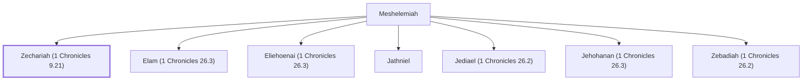

# Zechariah (1 Chronicles 9.21)

Levite gatekeeper and musician during David's reign

**Original-language names:** זְכַרְיָהוּ (H2148a)

## When

- **Placed around:** [[connections/timeline/11th century BC|1042 BC]] *(Ussher: the median date of the passages naming them)*

## Family

- **Father:** [[connections/people/Meshelemiah|Meshelemiah]]
- **Brothers and sisters:** [[connections/people/Elam (1 Chronicles 26.3)|Elam (1 Chronicles 26.3)]], [[connections/people/Eliehoenai (1 Chronicles 26.3)|Eliehoenai (1 Chronicles 26.3)]], [[connections/people/Jathniel|Jathniel]], [[connections/people/Jediael (1 Chronicles 26.2)|Jediael (1 Chronicles 26.2)]], [[connections/people/Jehohanan (1 Chronicles 26.3)|Jehohanan (1 Chronicles 26.3)]], [[connections/people/Zebadiah (1 Chronicles 26.2)|Zebadiah (1 Chronicles 26.2)]]
- **Tribe or nation:** Tribe of Levi

**Family group:** [[connections/genealogy/Family of Meshelemiah|Family of Meshelemiah]], generation 2

## Appears in

[[connections/chapters/13-1-chronicles/1 Chronicles 9|1 Chronicles 9]] · [[connections/chapters/13-1-chronicles/1 Chronicles 15|1 Chronicles 15 (3)]] · [[connections/chapters/13-1-chronicles/1 Chronicles 16|1 Chronicles 16]] · [[connections/chapters/13-1-chronicles/1 Chronicles 26|1 Chronicles 26 (2)]]

## Appears in the same verse as

[[connections/people/Benaiah (1 Chronicles 15.18)|Benaiah (1 Chronicles 15.18) (4)]] · [[connections/people/Eliab (1 Chronicles 15.18)|Eliab (1 Chronicles 15.18) (3)]] · [[connections/people/Jaaziel|Jaaziel (3)]] · [[connections/people/Jehiel (1 Chronicles 15.18)|Jehiel (1 Chronicles 15.18) (3)]] · [[connections/people/Jeiel (1 Chronicles 15.18)|Jeiel (1 Chronicles 15.18) (3)]] · [[connections/people/Meshelemiah|Meshelemiah (3)]] · [[connections/people/Obed-edom|Obed-edom (3)]] · [[connections/people/Shemiramoth (1 Chronicles 15.18)|Shemiramoth (1 Chronicles 15.18) (3)]] · [[connections/people/Maaseiah (1 Chronicles 15.18)|Maaseiah (1 Chronicles 15.18) (2)]] · [[connections/people/Mattithiah (1 Chronicles 15.18)|Mattithiah (1 Chronicles 15.18) (2)]] · [[connections/people/Unni (1 Chronicles 15.18)|Unni (1 Chronicles 15.18) (2)]] · [[connections/people/Amasai (1 Chronicles 15.24)|Amasai (1 Chronicles 15.24)]] · [[connections/people/Asaph (1 Chronicles 6.24)|Asaph (1 Chronicles 6.24)]] · [[connections/people/Ben|Ben]] · [[connections/people/Eliezer (1 Chronicles 15.24)|Eliezer (1 Chronicles 15.24)]] · [[connections/people/Eliphelehu|Eliphelehu]] · [[connections/people/Jathniel|Jathniel]] · [[connections/people/Jediael (1 Chronicles 26.2)|Jediael (1 Chronicles 26.2)]] · [[connections/people/Joshaphat (1 Chronicles 15.24)|Joshaphat (1 Chronicles 15.24)]] · [[connections/people/Mikneiah|Mikneiah]] · [[connections/people/Nethanel (1 Chronicles 15.24)|Nethanel (1 Chronicles 15.24)]] · [[connections/people/Shebaniah (1 Chronicles 15.24)|Shebaniah (1 Chronicles 15.24)]] · [[connections/people/Zebadiah (1 Chronicles 26.2)|Zebadiah (1 Chronicles 26.2)]]
