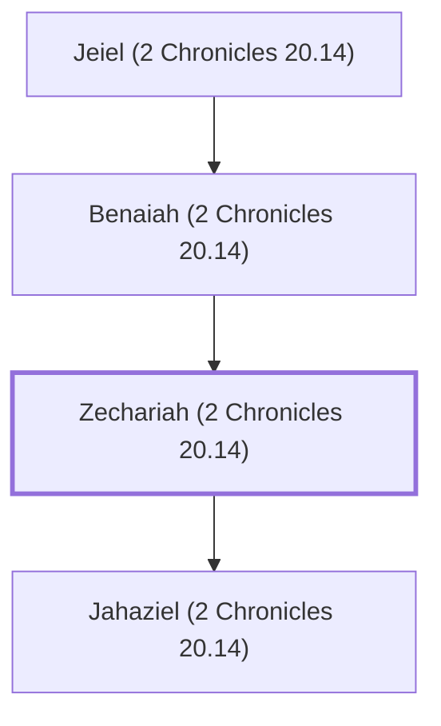

# Zechariah (2 Chronicles 20.14)

Levite who prophesied during Jehoshaphat's reign

**Original-language names:** זְכַרְיָהוּ (H2148a)

## Family

- **Father:** [[connections/people/Benaiah (2 Chronicles 20.14)|Benaiah (2 Chronicles 20.14)]]
- **Children:** [[connections/people/Jahaziel (2 Chronicles 20.14)|Jahaziel (2 Chronicles 20.14)]]
- **Tribe or nation:** Tribe of Judah

**Line of descent** (4 generations, father to son): [[connections/people/Mattaniah (2 Chronicles 20.14)|Mattaniah (2 Chronicles 20.14)]] → [[connections/people/Jeiel (2 Chronicles 20.14)|Jeiel (2 Chronicles 20.14)]] → [[connections/people/Benaiah (2 Chronicles 20.14)|Benaiah (2 Chronicles 20.14)]] → **Zechariah (2 Chronicles 20.14)**

**Family group:** [[connections/genealogy/Family of Mattaniah (2 Chronicles 20.14)|Family of Mattaniah (2 Chronicles 20.14)]], generation 4

## Appears in

[[connections/chapters/14-2-chronicles/2 Chronicles 20|2 Chronicles 20]]

## Appears in the same verse as

[[connections/people/Asaph (1 Chronicles 6.24)|Asaph (1 Chronicles 6.24)]] · [[connections/people/Benaiah (2 Chronicles 20.14)|Benaiah (2 Chronicles 20.14)]] · [[connections/people/Jahaziel (2 Chronicles 20.14)|Jahaziel (2 Chronicles 20.14)]] · [[connections/people/Jeiel (2 Chronicles 20.14)|Jeiel (2 Chronicles 20.14)]] · [[connections/people/Mattaniah (2 Chronicles 20.14)|Mattaniah (2 Chronicles 20.14)]]
