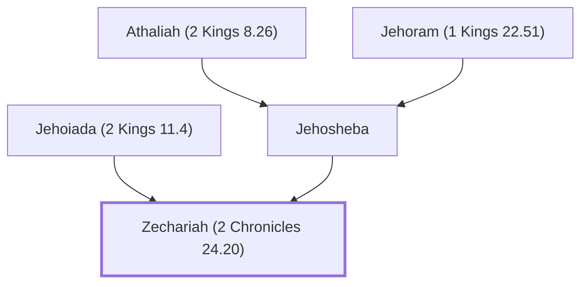

# Zechariah (2 Chronicles 24.20)

Priest murdered in the temple court

**Original-language names:** זְכַרְיָהוּ (H2148a) · Ζαχαρίας (G2197)

## When

- **Placed around:** [[connections/timeline/1st century AD|AD 33]] *(Ussher: the median date of the passages naming them)*

## Family

- **Father:** [[connections/people/Jehoiada (2 Kings 11.4)|Jehoiada (2 Kings 11.4)]]
- **Mother:** [[connections/people/Jehosheba|Jehosheba]]
- **Tribe or nation:** Tribe of Levi

**Family group:** [[connections/genealogy/Family of Adam|Family of Adam]], generation 45

## Appears in

[[connections/chapters/14-2-chronicles/2 Chronicles 24|2 Chronicles 24]] · [[connections/chapters/40-matthew/Matthew 23|Matthew 23]] · [[connections/chapters/42-luke/Luke 11|Luke 11]]

## Appears in the same verse as

[[connections/people/Abel|Abel (2)]] · [[connections/people/Jehoiada (2 Kings 11.4)|Jehoiada (2 Kings 11.4) (2)]]
