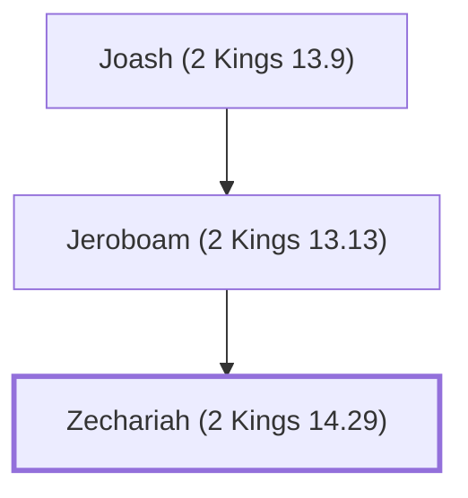

# Zechariah (2 Kings 14.29)

Last king of the northern kingdom of Israel

**Original-language names:** זְכַרְיָהוּ (H2148a)

## When

- **Placed around:** [[connections/timeline/8th century BC|773 BC]] *(Ussher: the median date of the passages naming them)*

## Family

- **Father:** [[connections/people/Jeroboam (2 Kings 13.13)|Jeroboam (2 Kings 13.13)]]
- **Tribe or nation:** Israel

**Line of descent** (7 generations, father to son): [[connections/people/Nimshi|Nimshi]] → [[connections/people/Jehoshaphat (2 Kings 9.2)|Jehoshaphat (2 Kings 9.2)]] → [[connections/people/Jehu (1 Kings 19.16)|Jehu (1 Kings 19.16)]] → [[connections/people/Jehoahaz (2 Kings 10.35)|Jehoahaz (2 Kings 10.35)]] → [[connections/people/Joash (2 Kings 13.9)|Joash (2 Kings 13.9)]] → [[connections/people/Jeroboam (2 Kings 13.13)|Jeroboam (2 Kings 13.13)]] → **Zechariah (2 Kings 14.29)**

**Family group:** [[connections/genealogy/Family of Nimshi|Family of Nimshi]], generation 7

## Appears in

[[connections/chapters/12-2-kings/2 Kings 14|2 Kings 14]] · [[connections/chapters/12-2-kings/2 Kings 15|2 Kings 15 (2)]]

## Appears in the same verse as

[[connections/people/Israel|Israel (3)]] · [[connections/people/Jeroboam (2 Kings 13.13)|Jeroboam (2 Kings 13.13) (2)]] · [[connections/people/Judah (Genesis 29.35)|Judah (Genesis 29.35)]] · [[connections/people/Uzziah (2 Kings 14.21)|Uzziah (2 Kings 14.21)]] · [[connections/places/Samaria|Samaria]]
