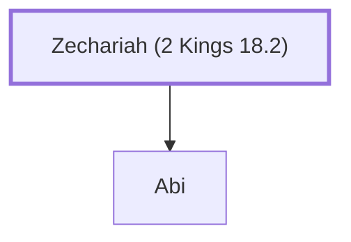

# Zechariah (2 Kings 18.2)

Mentioned in the genealogy of King Hezekiah

**Original-language names:** זְכַרְיָהוּ (H2148a)

## When

- **Placed around:** [[connections/timeline/8th century BC|726 BC]] *(Ussher: the median date of the passages naming them)*

## Family

- **Children:** [[connections/people/Abi|Abi]]

**Family group:** [[connections/genealogy/Family of Adam|Family of Adam]], generation 1

## Appears in

[[connections/chapters/12-2-kings/2 Kings 18|2 Kings 18]] · [[connections/chapters/14-2-chronicles/2 Chronicles 29|2 Chronicles 29]]

## Appears in the same verse as

[[connections/people/Abi|Abi (2)]] · [[connections/places/Jerusalem|Jerusalem (2)]] · [[connections/people/Hezekiah (2 Kings 16.20)|Hezekiah (2 Kings 16.20)]]
