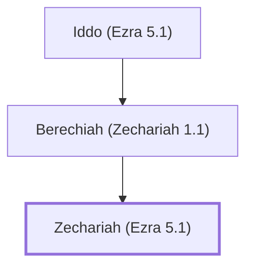

# Zechariah (Ezra 5.1)

Post-exilic prophet who wrote the book of Zechariah

**Original-language names:** זְכַרְיָהוּ (H2148a) · זְכַרְיָה (H2148b)

## When

- **Placed around:** [[connections/timeline/6th century BC|518 BC]] *(Ussher: the median date of the passages naming them)*

## Family

- **Father:** [[connections/people/Berechiah (Zechariah 1.1)|Berechiah (Zechariah 1.1)]]

**Line of descent** (3 generations, father to son): [[connections/people/Iddo (Ezra 5.1)|Iddo (Ezra 5.1)]] → [[connections/people/Berechiah (Zechariah 1.1)|Berechiah (Zechariah 1.1)]] → **Zechariah (Ezra 5.1)**

**Family group:** [[connections/genealogy/Family of Iddo (Ezra 5.1)|Family of Iddo (Ezra 5.1)]], generation 3

## Events

- [[connections/timeline/6th century BC|520 BC]] · [[connections/events/Prophecies of Zechariah|Prophecies of Zechariah]]

## Appears in

[[connections/chapters/15-ezra/Ezra 5|Ezra 5]] · [[connections/chapters/15-ezra/Ezra 6|Ezra 6]] · [[connections/chapters/38-zechariah/Zechariah 1|Zechariah 1 (2)]] · [[connections/chapters/38-zechariah/Zechariah 7|Zechariah 7 (2)]]

## Appears in the same verse as

[[connections/people/Darius (Ezra 4.5)|Darius (Ezra 4.5) (4)]] · [[connections/people/Iddo (Ezra 5.1)|Iddo (Ezra 5.1) (4)]] · [[connections/people/Berechiah (Zechariah 1.1)|Berechiah (Zechariah 1.1) (2)]] · [[connections/people/Haggai|Haggai (2)]] · [[connections/people/Israel|Israel (2)]] · [[connections/people/Judah (Genesis 29.35)|Judah (Genesis 29.35) (2)]] · [[connections/people/Artaxerxes|Artaxerxes]] · [[connections/people/Cyrus|Cyrus]] · [[connections/places/Jerusalem|Jerusalem]] · [[connections/places/Judea|Judea]] · [[connections/places/Persia|Persia]]
