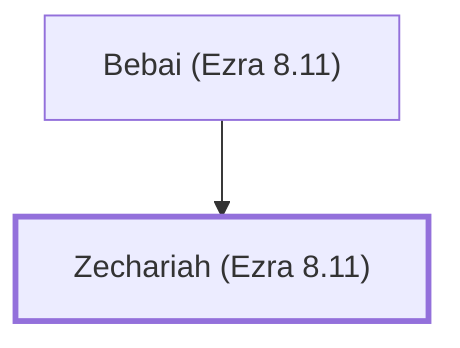

# Zechariah (Ezra 8.11)

Descendant of Bebai who returned with Ezra

**Original-language names:** זְכַרְיָהוּ (H2148a)

## When

- **Placed around:** [[connections/timeline/5th century BC|457 BC]] *(Ussher: the median date of the passages naming them)*

## Family

- **Father:** [[connections/people/Bebai (Ezra 8.11)|Bebai (Ezra 8.11)]]

**Family group:** [[connections/genealogy/Family of Bebai (Ezra 8.11)|Family of Bebai (Ezra 8.11)]], generation 2

## Appears in

[[connections/chapters/15-ezra/Ezra 8|Ezra 8]]

## Appears in the same verse as

[[connections/people/Bebai (Ezra 2.11)|Bebai (Ezra 2.11)]] · [[connections/people/Bebai (Ezra 8.11)|Bebai (Ezra 8.11)]]
