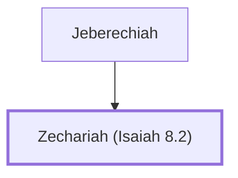

# Zechariah (Isaiah 8.2)

Witness to Isaiah's prophecy about Maher-Shalal-Hash-Baz

**Original-language names:** זְכַרְיָהוּ (H2148a)

## Family

- **Father:** [[connections/people/Jeberechiah|Jeberechiah]]

**Family group:** [[connections/genealogy/Family of Jeberechiah|Family of Jeberechiah]], generation 2

## Appears in

[[connections/chapters/23-isaiah/Isaiah 8|Isaiah 8]]

## Appears in the same verse as

[[connections/people/Jeberechiah|Jeberechiah]] · [[connections/people/Uriah (2 Kings 16.10)|Uriah (2 Kings 16.10)]]
