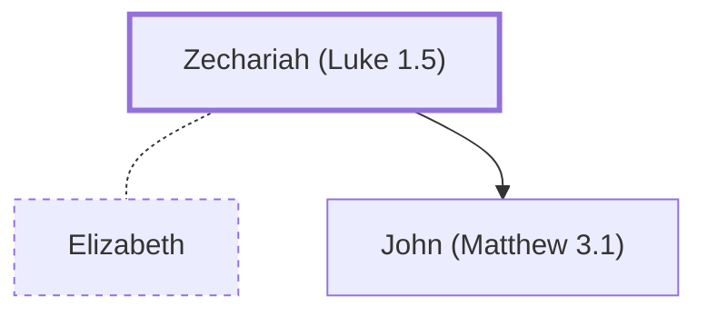

# Zechariah (Luke 1.5)

Priest, father of John the Baptist

**Original-language names:** Ζαχαρίας (G2197)

## When

- **Placed around:** [[connections/timeline/1st century BC|5 BC]] *(Ussher: the median date of the passages naming them)*

## Family

- **Spouses:** [[connections/people/Elizabeth|Elizabeth]]
- **Children:** [[connections/people/John (Matthew 3.1)|John (Matthew 3.1)]]

**Family group:** [[connections/genealogy/Family of Adam|Family of Adam]], generation 2

## Appears in

[[connections/chapters/42-luke/Luke 1|Luke 1 (8)]] · [[connections/chapters/42-luke/Luke 3|Luke 3]]

## Appears in the same verse as

[[connections/people/Elizabeth|Elizabeth (3)]] · [[connections/people/John (Matthew 3.1)|John (Matthew 3.1) (2)]] · [[connections/people/Aaron|Aaron]] · [[connections/people/Abijah (1 Chronicles 24.10)|Abijah (1 Chronicles 24.10)]] · [[connections/people/Annas|Annas]] · [[connections/people/Caiaphas|Caiaphas]] · [[connections/people/Herod (Matthew 2.1)|Herod (Matthew 2.1)]] · [[connections/places/Judea|Judea]]
