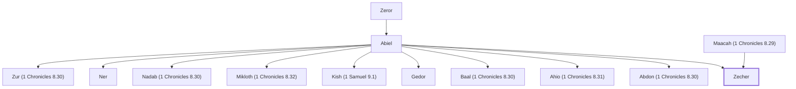

# Zecher

Son of Abiel, founder of Gibeon

**Also called:** Zechariah

**Original-language names:** זֶ֫כֶר (H2144) · זְכַרְיָהוּ (H2148a)

## When

- **Placed around:** [[connections/timeline/12th century BC|1200 BC]] *(Ussher: the median date of the passages naming them)*

## Family

- **Father:** [[connections/people/Abiel|Abiel]]
- **Mother:** [[connections/people/Maacah (1 Chronicles 8.29)|Maacah (1 Chronicles 8.29)]]
- **Brothers and sisters:** [[connections/people/Abdon (1 Chronicles 8.30)|Abdon (1 Chronicles 8.30)]], [[connections/people/Ahio (1 Chronicles 8.31)|Ahio (1 Chronicles 8.31)]], [[connections/people/Baal (1 Chronicles 8.30)|Baal (1 Chronicles 8.30)]], [[connections/people/Gedor|Gedor]], [[connections/people/Kish (1 Samuel 9.1)|Kish (1 Samuel 9.1)]], [[connections/people/Mikloth (1 Chronicles 8.32)|Mikloth (1 Chronicles 8.32)]], [[connections/people/Nadab (1 Chronicles 8.30)|Nadab (1 Chronicles 8.30)]], [[connections/people/Ner|Ner]], [[connections/people/Zur (1 Chronicles 8.30)|Zur (1 Chronicles 8.30)]]
- **Tribe or nation:** Tribe of Benjamin

**Line of descent** (5 generations, father to son): [[connections/people/Aphiah|Aphiah]] → [[connections/people/Becorath|Becorath]] → [[connections/people/Zeror|Zeror]] → [[connections/people/Abiel|Abiel]] → **Zecher**

**Family group:** [[connections/genealogy/Family of Aphiah|Family of Aphiah]], generation 5

## Appears in

[[connections/chapters/13-1-chronicles/1 Chronicles 8|1 Chronicles 8]] · [[connections/chapters/13-1-chronicles/1 Chronicles 9|1 Chronicles 9]]

## Appears in the same verse as

[[connections/people/Ahio (1 Chronicles 8.31)|Ahio (1 Chronicles 8.31) (2)]] · [[connections/people/Gedor|Gedor (2)]] · [[connections/people/Mikloth (1 Chronicles 8.32)|Mikloth (1 Chronicles 8.32)]]
