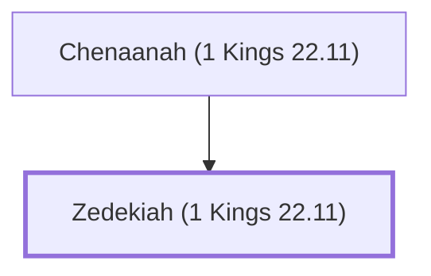

# Zedekiah (1 Kings 22.11)

False prophet who opposed Micaiah

**Original-language names:** צִדְקִיָּ֫הוּ (H6667)

## When

- **Placed around:** [[connections/timeline/9th century BC|897 BC]] *(Ussher: the median date of the passages naming them)*

## Family

- **Father:** [[connections/people/Chenaanah (1 Kings 22.11)|Chenaanah (1 Kings 22.11)]]

**Family group:** [[connections/genealogy/Family of Chenaanah (1 Kings 22.11)|Family of Chenaanah (1 Kings 22.11)]], generation 2

## Appears in

[[connections/chapters/11-1-kings/1 Kings 22|1 Kings 22 (2)]] · [[connections/chapters/14-2-chronicles/2 Chronicles 18|2 Chronicles 18 (2)]]

## Appears in the same verse as

[[connections/people/Chenaanah (1 Kings 22.11)|Chenaanah (1 Kings 22.11) (4)]] · [[connections/people/Micaiah (1 Kings 22.8)|Micaiah (1 Kings 22.8) (2)]] · [[connections/places/Syria|Syria (2)]]
