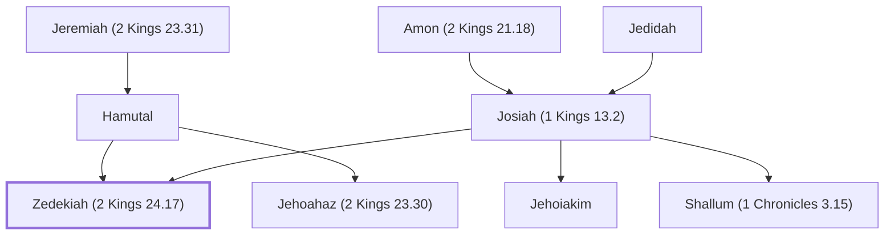

# Zedekiah (2 Kings 24.17)

Last king of Judah before the Babylonian exile

**Also called:** Mattaniah, Jehoiakim

**Original-language names:** צִדְקִיָּ֫הוּ (H6667) · מַתַּנְיָ֫הוּ (H4983) · יְהוֹיָקִים (H3079)

## When

- **Lived:** [[connections/timeline/7th century BC|618 BC]] – ? *(Jones)*
- **Placed around:** [[connections/timeline/6th century BC|590 BC]] *(Ussher: the median date of the passages naming them)*

## Family

- **Father:** [[connections/people/Josiah (1 Kings 13.2)|Josiah (1 Kings 13.2)]]
- **Mother:** [[connections/people/Hamutal|Hamutal]]
- **Brothers and sisters:** [[connections/people/Jehoahaz (2 Kings 23.30)|Jehoahaz (2 Kings 23.30)]], [[connections/people/Jehoiakim|Jehoiakim]], [[connections/people/Shallum (1 Chronicles 3.15)|Shallum (1 Chronicles 3.15)]]
- **Tribe or nation:** Tribe of Judah

**Line of descent** (51 generations, father to son): [[connections/people/Adam|Adam]] → [[connections/people/Seth|Seth]] → [[connections/people/Enosh|Enosh]] → [[connections/people/Kenan|Kenan]] → [[connections/people/Mahalalel (Genesis 5.12)|Mahalalel (Genesis 5.12)]] → [[connections/people/Jared|Jared]] → [[connections/people/Enoch (Genesis 5.18)|Enoch (Genesis 5.18)]] → [[connections/people/Methuselah|Methuselah]] → [[connections/people/Lamech (Genesis 5.25)|Lamech (Genesis 5.25)]] → [[connections/people/Noah (Genesis 5.29)|Noah (Genesis 5.29)]] → [[connections/people/Shem|Shem]] → [[connections/people/Arpachshad|Arpachshad]] → [[connections/people/Cainan|Cainan]] → [[connections/people/Shelah (Genesis 10.24)|Shelah (Genesis 10.24)]] → [[connections/people/Eber (Genesis 10.21)|Eber (Genesis 10.21)]] → [[connections/people/Peleg|Peleg]] → [[connections/people/Reu|Reu]] → [[connections/people/Serug|Serug]] → [[connections/people/Nahor (Genesis 11.22)|Nahor (Genesis 11.22)]] → [[connections/people/Terah|Terah]] → [[connections/people/Abraham|Abraham]] → [[connections/people/Isaac|Isaac]] → [[connections/people/Israel|Israel]] → [[connections/people/Judah (Genesis 29.35)|Judah (Genesis 29.35)]] → [[connections/people/Perez|Perez]] → [[connections/people/Hezron (Genesis 46.12)|Hezron (Genesis 46.12)]] → [[connections/people/Ram (Ruth 4.19)|Ram (Ruth 4.19)]] → [[connections/people/Amminadab (Exodus 6.23)|Amminadab (Exodus 6.23)]] → [[connections/people/Nahshon|Nahshon]] → [[connections/people/Salmon|Salmon]] → [[connections/people/Boaz|Boaz]] → [[connections/people/Obed (Ruth 4.17)|Obed (Ruth 4.17)]] → [[connections/people/Jesse|Jesse]] → [[connections/people/David|David]] → [[connections/people/Solomon|Solomon]] → [[connections/people/Rehoboam|Rehoboam]] → [[connections/people/Abijah (1 Kings 14.31)|Abijah (1 Kings 14.31)]] → [[connections/people/Asa (1 Kings 15.8)|Asa (1 Kings 15.8)]] → [[connections/people/Jehoshaphat (1 Kings 15.24)|Jehoshaphat (1 Kings 15.24)]] → [[connections/people/Jehoram (1 Kings 22.51)|Jehoram (1 Kings 22.51)]] → [[connections/people/Ahaziah (2 Kings 8.24)|Ahaziah (2 Kings 8.24)]] → [[connections/people/Joash (2 Kings 11.2)|Joash (2 Kings 11.2)]] → [[connections/people/Amaziah (2 Kings 12.22)|Amaziah (2 Kings 12.22)]] → [[connections/people/Uzziah (2 Kings 14.21)|Uzziah (2 Kings 14.21)]] → [[connections/people/Jotham (2 Kings 15.5)|Jotham (2 Kings 15.5)]] → [[connections/people/Ahaz (2 Kings 15.38)|Ahaz (2 Kings 15.38)]] → [[connections/people/Hezekiah (2 Kings 16.20)|Hezekiah (2 Kings 16.20)]] → [[connections/people/Manasseh (2 Kings 20.21)|Manasseh (2 Kings 20.21)]] → [[connections/people/Amon (2 Kings 21.18)|Amon (2 Kings 21.18)]] → [[connections/people/Josiah (1 Kings 13.2)|Josiah (1 Kings 13.2)]] → **Zedekiah (2 Kings 24.17)**

**Family group:** [[connections/genealogy/Family of Adam|Family of Adam]], generation 51

## Events

- [[connections/timeline/6th century BC|597 BC]] · [[connections/events/Reign of Zedekiah|Reign of Zedekiah]]

## Appears in

[[connections/chapters/12-2-kings/2 Kings 24|2 Kings 24 (3)]] · [[connections/chapters/12-2-kings/2 Kings 25|2 Kings 25 (2)]] · [[connections/chapters/13-1-chronicles/1 Chronicles 3|1 Chronicles 3]] · [[connections/chapters/14-2-chronicles/2 Chronicles 36|2 Chronicles 36 (2)]] · [[connections/chapters/24-jeremiah/Jeremiah 1|Jeremiah 1]] · [[connections/chapters/24-jeremiah/Jeremiah 21|Jeremiah 21 (3)]] · [[connections/chapters/24-jeremiah/Jeremiah 24|Jeremiah 24]] · [[connections/chapters/24-jeremiah/Jeremiah 27|Jeremiah 27 (3)]] · [[connections/chapters/24-jeremiah/Jeremiah 28|Jeremiah 28]] · [[connections/chapters/24-jeremiah/Jeremiah 29|Jeremiah 29]] · [[connections/chapters/24-jeremiah/Jeremiah 32|Jeremiah 32 (4)]] · [[connections/chapters/24-jeremiah/Jeremiah 34|Jeremiah 34 (5)]] · [[connections/chapters/24-jeremiah/Jeremiah 37|Jeremiah 37 (5)]] · [[connections/chapters/24-jeremiah/Jeremiah 38|Jeremiah 38 (7)]] · [[connections/chapters/24-jeremiah/Jeremiah 39|Jeremiah 39 (6)]] · [[connections/chapters/24-jeremiah/Jeremiah 44|Jeremiah 44]] · [[connections/chapters/24-jeremiah/Jeremiah 49|Jeremiah 49]] · [[connections/chapters/24-jeremiah/Jeremiah 51|Jeremiah 51]] · [[connections/chapters/24-jeremiah/Jeremiah 52|Jeremiah 52 (6)]]

## Appears in the same verse as

[[connections/people/Judah (Genesis 29.35)|Judah (Genesis 29.35) (26)]] · [[connections/places/Babylon|Babylon (24)]] · [[connections/people/Jeremiah (2 Chronicles 35.25)|Jeremiah (2 Chronicles 35.25) (18)]] · [[connections/places/Jerusalem|Jerusalem (12)]] · [[connections/people/Nebuchadnezzar|Nebuchadnezzar (8)]] · [[connections/places/Chaldea|Chaldea (5)]] · [[connections/people/Jehoiakim|Jehoiakim (4)]] · [[connections/people/Josiah (1 Kings 13.2)|Josiah (1 Kings 13.2) (4)]] · [[connections/places/Riblah (2 Kings 23.33)|Riblah (2 Kings 23.33) (3)]] · [[connections/people/Hamutal|Hamutal (2)]] · [[connections/people/Israel|Israel (2)]] · [[connections/people/Jeremiah (2 Kings 23.31)|Jeremiah (2 Kings 23.31) (2)]] · [[connections/people/Maaseiah (Jeremiah 21.1)|Maaseiah (Jeremiah 21.1) (2)]] · [[connections/people/Zephaniah (2 Kings 25.18)|Zephaniah (2 Kings 25.18) (2)]] · [[connections/places/Egypt|Egypt (2)]] · [[connections/places/Jericho|Jericho (2)]] · [[connections/places/Libnah (Joshua 10.29)|Libnah (Joshua 10.29) (2)]] · [[connections/people/Azzur (Jeremiah 28.1)|Azzur (Jeremiah 28.1)]] · [[connections/people/Elasah (Jeremiah 29.3)|Elasah (Jeremiah 29.3)]] · [[connections/people/Gemariah (Jeremiah 29.3)|Gemariah (Jeremiah 29.3)]] · [[connections/people/Hananiah (Jeremiah 28.1)|Hananiah (Jeremiah 28.1)]] · [[connections/people/Hilkiah (2 Kings 22.4)|Hilkiah (2 Kings 22.4)]] · [[connections/people/Hophra|Hophra]] · [[connections/people/Jehoahaz (2 Kings 23.30)|Jehoahaz (2 Kings 23.30)]] · [[connections/people/Jehoiachin|Jehoiachin]] · [[connections/people/Jehucal|Jehucal]] · [[connections/people/Mahseiah|Mahseiah]] · [[connections/people/Malchiah|Malchiah]] · [[connections/people/Neriah|Neriah]] · [[connections/people/Pashhur (Jeremiah 21.1)|Pashhur (Jeremiah 21.1)]] · [[connections/people/Seraiah (Jeremiah 51.59)|Seraiah (Jeremiah 51.59)]] · [[connections/people/Shallum (1 Chronicles 3.15)|Shallum (1 Chronicles 3.15)]] · [[connections/people/Shaphan (2 Kings 22.3)|Shaphan (2 Kings 22.3)]] · [[connections/people/Shelemiah (Jeremiah 37.3)|Shelemiah (Jeremiah 37.3)]] · [[connections/places/Ammon|Ammon]] · [[connections/places/Arabah|Arabah]] · [[connections/places/Edom|Edom]] · [[connections/places/Elam|Elam]] · [[connections/places/Gibeon|Gibeon]] · [[connections/places/Hamath|Hamath]] · [[connections/places/Moab|Moab]] · [[connections/places/Sidon|Sidon]] · [[connections/places/Tyre|Tyre]]
