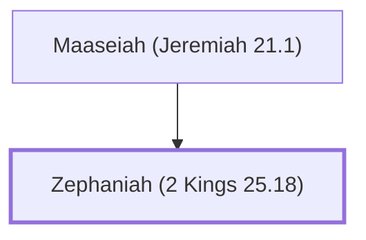

# Zephaniah (2 Kings 25.18)

Priest during the reign of Zedekiah

**Original-language names:** צְפַנְיָהוּ (H6846)

## When

- **Placed around:** [[connections/timeline/6th century BC|589 BC]] *(Ussher: the median date of the passages naming them)*

## Family

- **Father:** [[connections/people/Maaseiah (Jeremiah 21.1)|Maaseiah (Jeremiah 21.1)]]

**Family group:** [[connections/genealogy/Family of Maaseiah (Jeremiah 21.1)|Family of Maaseiah (Jeremiah 21.1)]], generation 2

## Appears in

[[connections/chapters/12-2-kings/2 Kings 25|2 Kings 25]] · [[connections/chapters/24-jeremiah/Jeremiah 21|Jeremiah 21]] · [[connections/chapters/24-jeremiah/Jeremiah 29|Jeremiah 29 (2)]] · [[connections/chapters/24-jeremiah/Jeremiah 37|Jeremiah 37]] · [[connections/chapters/24-jeremiah/Jeremiah 52|Jeremiah 52]]

## Appears in the same verse as

[[connections/people/Jeremiah (2 Chronicles 35.25)|Jeremiah (2 Chronicles 35.25) (3)]] · [[connections/people/Maaseiah (Jeremiah 21.1)|Maaseiah (Jeremiah 21.1) (3)]] · [[connections/people/Seraiah (2 Kings 25.18)|Seraiah (2 Kings 25.18) (2)]] · [[connections/people/Zedekiah (2 Kings 24.17)|Zedekiah (2 Kings 24.17) (2)]] · [[connections/people/Israel|Israel]] · [[connections/people/Jehucal|Jehucal]] · [[connections/people/Malchiah|Malchiah]] · [[connections/people/Pashhur (Jeremiah 21.1)|Pashhur (Jeremiah 21.1)]] · [[connections/people/Shelemiah (Jeremiah 37.3)|Shelemiah (Jeremiah 37.3)]] · [[connections/places/Jerusalem|Jerusalem]]
