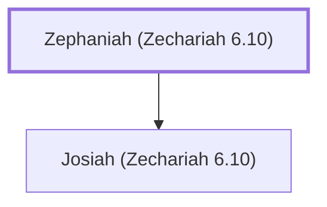

# Zephaniah (Zechariah 6.10)

One of the men in Zechariah's prophecy

**Original-language names:** צְפַנְיָהוּ (H6846)

## When

- **Placed around:** [[connections/timeline/6th century BC|519 BC]] *(Ussher: the median date of the passages naming them)*

## Family

- **Children:** [[connections/people/Josiah (Zechariah 6.10)|Josiah (Zechariah 6.10)]]

**Family group:** [[connections/genealogy/Family of Zephaniah (Zechariah 6.10)|Family of Zephaniah (Zechariah 6.10)]], generation 1

## Appears in

[[connections/chapters/38-zechariah/Zechariah 6|Zechariah 6 (2)]]

## Appears in the same verse as

[[connections/people/Heldai|Heldai (2)]] · [[connections/people/Jedaiah (Zechariah 6.10)|Jedaiah (Zechariah 6.10) (2)]] · [[connections/people/Josiah (Zechariah 6.10)|Josiah (Zechariah 6.10) (2)]] · [[connections/people/Tobijah (Zechariah 6.10)|Tobijah (Zechariah 6.10) (2)]] · [[connections/places/Babylon|Babylon]]
