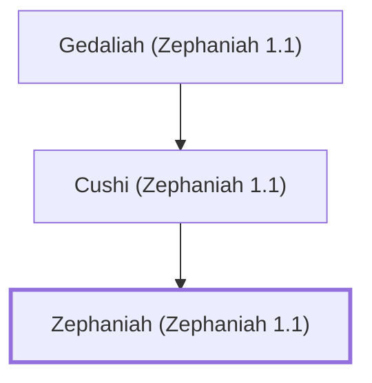

# Zephaniah (Zephaniah 1.1)

Prophet, son of Cushi, descendant of Hezekiah

**Original-language names:** צְפַנְיָהוּ (H6846)

## When

- **Placed around:** [[connections/timeline/7th century BC|630 BC]] *(Ussher: the median date of the passages naming them)*

## Family

- **Father:** [[connections/people/Cushi (Zephaniah 1.1)|Cushi (Zephaniah 1.1)]]

**Line of descent** (5 generations, father to son): [[connections/people/Hezekiah (Zephaniah 1.1)|Hezekiah (Zephaniah 1.1)]] → [[connections/people/Amariah (Zephaniah 1.1)|Amariah (Zephaniah 1.1)]] → [[connections/people/Gedaliah (Zephaniah 1.1)|Gedaliah (Zephaniah 1.1)]] → [[connections/people/Cushi (Zephaniah 1.1)|Cushi (Zephaniah 1.1)]] → **Zephaniah (Zephaniah 1.1)**

**Family group:** [[connections/genealogy/Family of Hezekiah (Zephaniah 1.1)|Family of Hezekiah (Zephaniah 1.1)]], generation 5

## Events

- [[connections/timeline/7th century BC|610 BC]] · [[connections/events/Prophecies of Zephaniah|Prophecies of Zephaniah]]

## Appears in

[[connections/chapters/36-zephaniah/Zephaniah 1|Zephaniah 1]]

## Appears in the same verse as

[[connections/people/Amariah (Zephaniah 1.1)|Amariah (Zephaniah 1.1)]] · [[connections/people/Amon (2 Kings 21.18)|Amon (2 Kings 21.18)]] · [[connections/people/Cushi (Zephaniah 1.1)|Cushi (Zephaniah 1.1)]] · [[connections/people/Gedaliah (Zephaniah 1.1)|Gedaliah (Zephaniah 1.1)]] · [[connections/people/Hezekiah (Zephaniah 1.1)|Hezekiah (Zephaniah 1.1)]] · [[connections/people/Josiah (1 Kings 13.2)|Josiah (1 Kings 13.2)]] · [[connections/people/Judah (Genesis 29.35)|Judah (Genesis 29.35)]]
