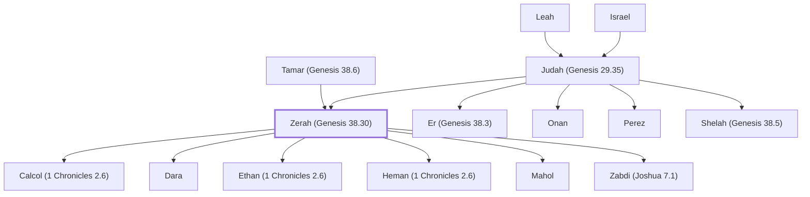

# Zerah (Genesis 38.30)

Son of Judah, twin of Perez

**Original-language names:** זֶ֫רַח (H2226) · Ζαρά (G2196)

## When

- **Placed around:** [[connections/timeline/15th century BC|1451 BC]] *(Ussher: the median date of the passages naming them)*

## Family

- **Father:** [[connections/people/Judah (Genesis 29.35)|Judah (Genesis 29.35)]]
- **Mother:** [[connections/people/Tamar (Genesis 38.6)|Tamar (Genesis 38.6)]]
- **Brothers and sisters:** [[connections/people/Er (Genesis 38.3)|Er (Genesis 38.3)]], [[connections/people/Onan|Onan]], [[connections/people/Perez|Perez]], [[connections/people/Shelah (Genesis 38.5)|Shelah (Genesis 38.5)]]
- **Children:** [[connections/people/Calcol (1 Chronicles 2.6)|Calcol (1 Chronicles 2.6)]], [[connections/people/Dara|Dara]], [[connections/people/Ethan (1 Chronicles 2.6)|Ethan (1 Chronicles 2.6)]], [[connections/people/Heman (1 Chronicles 2.6)|Heman (1 Chronicles 2.6)]], [[connections/people/Mahol|Mahol (ancestor)]], [[connections/people/Zabdi (Joshua 7.1)|Zabdi (Joshua 7.1)]]
- **Tribe or nation:** Tribe of Judah

**Line of descent** (25 generations, father to son): [[connections/people/Adam|Adam]] → [[connections/people/Seth|Seth]] → [[connections/people/Enosh|Enosh]] → [[connections/people/Kenan|Kenan]] → [[connections/people/Mahalalel (Genesis 5.12)|Mahalalel (Genesis 5.12)]] → [[connections/people/Jared|Jared]] → [[connections/people/Enoch (Genesis 5.18)|Enoch (Genesis 5.18)]] → [[connections/people/Methuselah|Methuselah]] → [[connections/people/Lamech (Genesis 5.25)|Lamech (Genesis 5.25)]] → [[connections/people/Noah (Genesis 5.29)|Noah (Genesis 5.29)]] → [[connections/people/Shem|Shem]] → [[connections/people/Arpachshad|Arpachshad]] → [[connections/people/Cainan|Cainan]] → [[connections/people/Shelah (Genesis 10.24)|Shelah (Genesis 10.24)]] → [[connections/people/Eber (Genesis 10.21)|Eber (Genesis 10.21)]] → [[connections/people/Peleg|Peleg]] → [[connections/people/Reu|Reu]] → [[connections/people/Serug|Serug]] → [[connections/people/Nahor (Genesis 11.22)|Nahor (Genesis 11.22)]] → [[connections/people/Terah|Terah]] → [[connections/people/Abraham|Abraham]] → [[connections/people/Isaac|Isaac]] → [[connections/people/Israel|Israel]] → [[connections/people/Judah (Genesis 29.35)|Judah (Genesis 29.35)]] → **Zerah (Genesis 38.30)**

**Family group:** [[connections/genealogy/Family of Adam|Family of Adam]], generation 25

## Appears in

[[connections/chapters/01-genesis/Genesis 38|Genesis 38]] · [[connections/chapters/01-genesis/Genesis 46|Genesis 46]] · [[connections/chapters/04-numbers/Numbers 26|Numbers 26]] · [[connections/chapters/06-joshua/Joshua 7|Joshua 7 (3)]] · [[connections/chapters/06-joshua/Joshua 22|Joshua 22]] · [[connections/chapters/13-1-chronicles/1 Chronicles 2|1 Chronicles 2 (2)]] · [[connections/chapters/13-1-chronicles/1 Chronicles 9|1 Chronicles 9]] · [[connections/chapters/16-nehemiah/Nehemiah 11|Nehemiah 11]] · [[connections/chapters/40-matthew/Matthew 1|Matthew 1]]

## Appears in the same verse as

[[connections/people/Judah (Genesis 29.35)|Judah (Genesis 29.35) (7)]] · [[connections/people/Achan|Achan (4)]] · [[connections/people/Perez|Perez (4)]] · [[connections/people/Israel|Israel (3)]] · [[connections/people/Zabdi (Joshua 7.1)|Zabdi (Joshua 7.1) (3)]] · [[connections/people/Carmi (Joshua 7.1)|Carmi (Joshua 7.1) (2)]] · [[connections/people/Hezron (Genesis 46.12)|Hezron (Genesis 46.12) (2)]] · [[connections/people/Shelah (Genesis 38.5)|Shelah (Genesis 38.5) (2)]] · [[connections/people/Tamar (Genesis 38.6)|Tamar (Genesis 38.6) (2)]] · [[connections/people/Calcol (1 Chronicles 2.6)|Calcol (1 Chronicles 2.6)]] · [[connections/people/Dara|Dara]] · [[connections/people/Er (Genesis 38.3)|Er (Genesis 38.3)]] · [[connections/people/Ethan (1 Chronicles 2.6)|Ethan (1 Chronicles 2.6)]] · [[connections/people/Hamul|Hamul]] · [[connections/people/Heman (1 Chronicles 2.6)|Heman (1 Chronicles 2.6)]] · [[connections/people/Jeuel (1 Chronicles 9.6)|Jeuel (1 Chronicles 9.6)]] · [[connections/people/Joshua (Exodus 17.9)|Joshua (Exodus 17.9)]] · [[connections/people/Meshezabel (Nehemiah 11.24)|Meshezabel (Nehemiah 11.24)]] · [[connections/people/Onan|Onan]] · [[connections/people/Pethahiah (Nehemiah 11.24)|Pethahiah (Nehemiah 11.24)]] · [[connections/people/Ram (Ruth 4.19)|Ram (Ruth 4.19)]] · [[connections/places/Achor Valley|Achor Valley]] · [[connections/places/Canaan|Canaan]]
