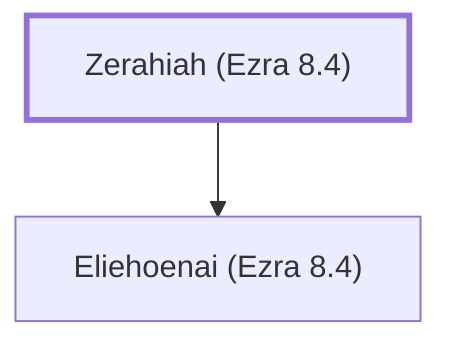

# Zerahiah (Ezra 8.4)

Descendant of Pahath-Moab who returned with Ezra

**Original-language names:** זְרַחְיָה (H2228)

## When

- **Placed around:** [[connections/timeline/5th century BC|457 BC]] *(Ussher: the median date of the passages naming them)*

## Family

- **Children:** [[connections/people/Eliehoenai (Ezra 8.4)|Eliehoenai (Ezra 8.4)]]

**Family group:** [[connections/genealogy/Family of Zerahiah (Ezra 8.4)|Family of Zerahiah (Ezra 8.4)]], generation 1

## Appears in

[[connections/chapters/15-ezra/Ezra 8|Ezra 8]]

## Appears in the same verse as

[[connections/people/Eliehoenai (Ezra 8.4)|Eliehoenai (Ezra 8.4)]] · [[connections/people/Pahath-moab (Ezra 2.6)|Pahath-moab (Ezra 2.6)]]
