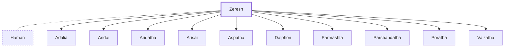

# Zeresh

Wife of Haman, enemy of the Jews

**Original-language names:** זֶ֫רֶשׁ (H2238)

## When

- **Placed around:** [[connections/timeline/5th century BC|453 BC]] *(Ussher: the median date of the passages naming them)*

## Family

- **Spouses:** [[connections/people/Haman|Haman]]
- **Children:** [[connections/people/Adalia|Adalia (uncertain)]], [[connections/people/Aridai|Aridai (uncertain)]], [[connections/people/Aridatha|Aridatha (uncertain)]], [[connections/people/Arisai|Arisai (uncertain)]], [[connections/people/Aspatha|Aspatha (uncertain)]], [[connections/people/Dalphon|Dalphon (uncertain)]], [[connections/people/Parmashta|Parmashta (uncertain)]], [[connections/people/Parshandatha|Parshandatha (uncertain)]], [[connections/people/Poratha|Poratha (uncertain)]], [[connections/people/Vaizatha|Vaizatha (uncertain)]]

**Family group:** [[connections/genealogy/Family of Hammedatha|Family of Hammedatha]], generation 2

## Appears in

[[connections/chapters/17-esther/Esther 5|Esther 5 (2)]] · [[connections/chapters/17-esther/Esther 6|Esther 6]]

## Appears in the same verse as

[[connections/people/Haman|Haman (3)]] · [[connections/people/Mordecai (Esther 2.5)|Mordecai (Esther 2.5) (2)]]
