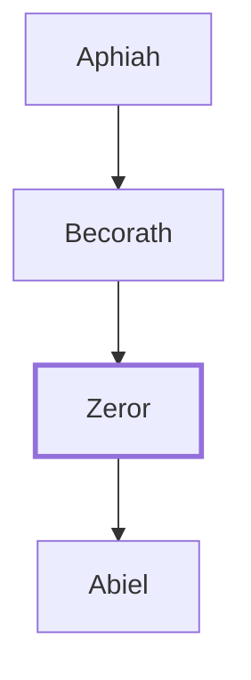

# Zeror

Ancestor of King Saul

**Original-language names:** צְרוֹר (H6872c)

## When

- **Placed around:** [[connections/timeline/11th century BC|1095 BC]] *(Ussher: the median date of the passages naming them)*

## Family

- **Father:** [[connections/people/Becorath|Becorath]]
- **Children:** [[connections/people/Abiel|Abiel]]
- **Tribe or nation:** Tribe of Benjamin

**Line of descent** (3 generations, father to son): [[connections/people/Aphiah|Aphiah]] → [[connections/people/Becorath|Becorath]] → **Zeror**

**Family group:** [[connections/genealogy/Family of Aphiah|Family of Aphiah]], generation 3

## Appears in

[[connections/chapters/09-1-samuel/1 Samuel 9|1 Samuel 9]]

## Appears in the same verse as

[[connections/people/Abiel|Abiel]] · [[connections/people/Aphiah|Aphiah]] · [[connections/people/Becorath|Becorath]] · [[connections/people/Benjamin (Genesis 35.18)|Benjamin (Genesis 35.18)]] · [[connections/people/Kish (1 Samuel 9.1)|Kish (1 Samuel 9.1)]]
