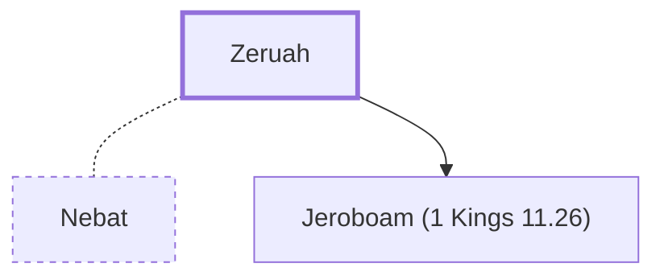

# Zeruah

Mother of Jeroboam, first king of Israel

**Original-language names:** צְרוּעָה (H6871)

## When

- **Placed around:** [[connections/timeline/10th century BC|984 BC]] *(Ussher: the median date of the passages naming them)*

## Family

- **Spouses:** [[connections/people/Nebat|Nebat]]
- **Children:** [[connections/people/Jeroboam (1 Kings 11.26)|Jeroboam (1 Kings 11.26)]]
- **Tribe or nation:** Israel

**Family group:** [[connections/genealogy/Family of Nebat|Family of Nebat]], generation 1

## Appears in

[[connections/chapters/11-1-kings/1 Kings 11|1 Kings 11]]

## Appears in the same verse as

[[connections/people/Jeroboam (1 Kings 11.26)|Jeroboam (1 Kings 11.26)]] · [[connections/people/Nebat|Nebat]] · [[connections/people/Solomon|Solomon]] · [[connections/places/Zeredah|Zeredah]]
