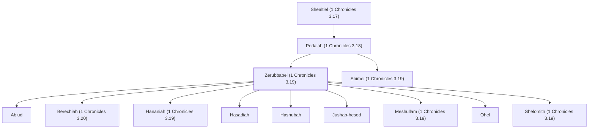

# Zerubbabel (1 Chronicles 3.19)

Leader of the first Jewish exiles from Babylon

**Also called:** Sheshbazzar

**Original-language names:** זְרֻבָּבֶ֫ל (H2216) · זְרֻבָּבֶ֫ל (H2217) · שֵׁשְׁבַּצַּר (H8339) · שֵׁשְׁבַּצַּר (H8340) · Ζοροβάβελ (G2216)

## When

- **Placed around:** [[connections/timeline/6th century BC|519 BC]] *(Ussher: the median date of the passages naming them)*

## Family

- **Father:** [[connections/people/Pedaiah (1 Chronicles 3.18)|Pedaiah (1 Chronicles 3.18)]]
- **Brothers and sisters:** [[connections/people/Shimei (1 Chronicles 3.19)|Shimei (1 Chronicles 3.19)]]
- **Children:** [[connections/people/Abiud|Abiud]], [[connections/people/Berechiah (1 Chronicles 3.20)|Berechiah (1 Chronicles 3.20)]], [[connections/people/Hananiah (1 Chronicles 3.19)|Hananiah (1 Chronicles 3.19)]], [[connections/people/Hasadiah|Hasadiah]], [[connections/people/Hashubah|Hashubah]], [[connections/people/Jushab-hesed|Jushab-hesed]], [[connections/people/Meshullam (1 Chronicles 3.19)|Meshullam (1 Chronicles 3.19)]], [[connections/people/Ohel|Ohel]], [[connections/people/Shelomith (1 Chronicles 3.19)|Shelomith (1 Chronicles 3.19)]]
- **Tribe or nation:** Tribe of Judah

**Line of descent** (55 generations, father to son): [[connections/people/Adam|Adam]] → [[connections/people/Seth|Seth]] → [[connections/people/Enosh|Enosh]] → [[connections/people/Kenan|Kenan]] → [[connections/people/Mahalalel (Genesis 5.12)|Mahalalel (Genesis 5.12)]] → [[connections/people/Jared|Jared]] → [[connections/people/Enoch (Genesis 5.18)|Enoch (Genesis 5.18)]] → [[connections/people/Methuselah|Methuselah]] → [[connections/people/Lamech (Genesis 5.25)|Lamech (Genesis 5.25)]] → [[connections/people/Noah (Genesis 5.29)|Noah (Genesis 5.29)]] → [[connections/people/Shem|Shem]] → [[connections/people/Arpachshad|Arpachshad]] → [[connections/people/Cainan|Cainan]] → [[connections/people/Shelah (Genesis 10.24)|Shelah (Genesis 10.24)]] → [[connections/people/Eber (Genesis 10.21)|Eber (Genesis 10.21)]] → [[connections/people/Peleg|Peleg]] → [[connections/people/Reu|Reu]] → [[connections/people/Serug|Serug]] → [[connections/people/Nahor (Genesis 11.22)|Nahor (Genesis 11.22)]] → [[connections/people/Terah|Terah]] → [[connections/people/Abraham|Abraham]] → [[connections/people/Isaac|Isaac]] → [[connections/people/Israel|Israel]] → [[connections/people/Judah (Genesis 29.35)|Judah (Genesis 29.35)]] → [[connections/people/Perez|Perez]] → [[connections/people/Hezron (Genesis 46.12)|Hezron (Genesis 46.12)]] → [[connections/people/Ram (Ruth 4.19)|Ram (Ruth 4.19)]] → [[connections/people/Amminadab (Exodus 6.23)|Amminadab (Exodus 6.23)]] → [[connections/people/Nahshon|Nahshon]] → [[connections/people/Salmon|Salmon]] → [[connections/people/Boaz|Boaz]] → [[connections/people/Obed (Ruth 4.17)|Obed (Ruth 4.17)]] → [[connections/people/Jesse|Jesse]] → [[connections/people/David|David]] → [[connections/people/Solomon|Solomon]] → [[connections/people/Rehoboam|Rehoboam]] → [[connections/people/Abijah (1 Kings 14.31)|Abijah (1 Kings 14.31)]] → [[connections/people/Asa (1 Kings 15.8)|Asa (1 Kings 15.8)]] → [[connections/people/Jehoshaphat (1 Kings 15.24)|Jehoshaphat (1 Kings 15.24)]] → [[connections/people/Jehoram (1 Kings 22.51)|Jehoram (1 Kings 22.51)]] → [[connections/people/Ahaziah (2 Kings 8.24)|Ahaziah (2 Kings 8.24)]] → [[connections/people/Joash (2 Kings 11.2)|Joash (2 Kings 11.2)]] → [[connections/people/Amaziah (2 Kings 12.22)|Amaziah (2 Kings 12.22)]] → [[connections/people/Uzziah (2 Kings 14.21)|Uzziah (2 Kings 14.21)]] → [[connections/people/Jotham (2 Kings 15.5)|Jotham (2 Kings 15.5)]] → [[connections/people/Ahaz (2 Kings 15.38)|Ahaz (2 Kings 15.38)]] → [[connections/people/Hezekiah (2 Kings 16.20)|Hezekiah (2 Kings 16.20)]] → [[connections/people/Manasseh (2 Kings 20.21)|Manasseh (2 Kings 20.21)]] → [[connections/people/Amon (2 Kings 21.18)|Amon (2 Kings 21.18)]] → [[connections/people/Josiah (1 Kings 13.2)|Josiah (1 Kings 13.2)]] → [[connections/people/Jehoiakim|Jehoiakim]] → [[connections/people/Jehoiachin|Jehoiachin]] → [[connections/people/Shealtiel (1 Chronicles 3.17)|Shealtiel (1 Chronicles 3.17)]] → [[connections/people/Pedaiah (1 Chronicles 3.18)|Pedaiah (1 Chronicles 3.18)]] → **Zerubbabel (1 Chronicles 3.19)**

**Family group:** [[connections/genealogy/Family of Adam|Family of Adam]], generation 55

## Appears in

[[connections/chapters/13-1-chronicles/1 Chronicles 3|1 Chronicles 3]] · [[connections/chapters/15-ezra/Ezra 1|Ezra 1 (2)]] · [[connections/chapters/15-ezra/Ezra 2|Ezra 2]] · [[connections/chapters/15-ezra/Ezra 3|Ezra 3 (2)]] · [[connections/chapters/15-ezra/Ezra 4|Ezra 4 (2)]] · [[connections/chapters/15-ezra/Ezra 5|Ezra 5 (3)]] · [[connections/chapters/16-nehemiah/Nehemiah 7|Nehemiah 7]] · [[connections/chapters/16-nehemiah/Nehemiah 12|Nehemiah 12 (2)]] · [[connections/chapters/37-haggai/Haggai 1|Haggai 1 (3)]] · [[connections/chapters/37-haggai/Haggai 2|Haggai 2 (4)]] · [[connections/chapters/38-zechariah/Zechariah 4|Zechariah 4 (4)]] · [[connections/chapters/40-matthew/Matthew 1|Matthew 1 (2)]]

## Appears in the same verse as

[[connections/people/Joshua (Ezra 2.2)|Joshua (Ezra 2.2) (12)]] · [[connections/people/Shealtiel (1 Chronicles 3.17)|Shealtiel (1 Chronicles 3.17) (10)]] · [[connections/people/Jehozadak|Jehozadak (8)]] · [[connections/people/Israel|Israel (5)]] · [[connections/people/Judah (Genesis 29.35)|Judah (Genesis 29.35) (5)]] · [[connections/places/Jerusalem|Jerusalem (5)]] · [[connections/people/Cyrus|Cyrus (3)]] · [[connections/places/Babylon|Babylon (3)]] · [[connections/people/Baanah (Ezra 2.2)|Baanah (Ezra 2.2) (2)]] · [[connections/people/Bigvai (Ezra 2.2)|Bigvai (Ezra 2.2) (2)]] · [[connections/people/Bilshan|Bilshan (2)]] · [[connections/people/Haggai|Haggai (2)]] · [[connections/people/Mispar|Mispar (2)]] · [[connections/people/Mordecai (Ezra 2.2)|Mordecai (Ezra 2.2) (2)]] · [[connections/people/Nehemiah (Ezra 2.2)|Nehemiah (Ezra 2.2) (2)]] · [[connections/people/Reelaiah|Reelaiah (2)]] · [[connections/people/Rehum (Ezra 2.2)|Rehum (Ezra 2.2) (2)]] · [[connections/people/Seraiah (Ezra 2.2)|Seraiah (Ezra 2.2) (2)]] · [[connections/places/Persia|Persia (2)]] · [[connections/people/Aaron|Aaron]] · [[connections/people/Abiud|Abiud]] · [[connections/people/Azariah (Nehemiah 7.7)|Azariah (Nehemiah 7.7)]] · [[connections/people/Azor|Azor]] · [[connections/people/Darius (Ezra 4.5)|Darius (Ezra 4.5)]] · [[connections/people/Eliakim (Matthew 1.13)|Eliakim (Matthew 1.13)]] · [[connections/people/Esarhaddon|Esarhaddon]] · [[connections/people/Ezra (Nehemiah 12.1)|Ezra (Nehemiah 12.1)]] · [[connections/people/Hananiah (1 Chronicles 3.19)|Hananiah (1 Chronicles 3.19)]] · [[connections/people/Jehoiachin|Jehoiachin]] · [[connections/people/Jeremiah (Nehemiah 10.3)|Jeremiah (Nehemiah 10.3)]] · [[connections/people/Meshullam (1 Chronicles 3.19)|Meshullam (1 Chronicles 3.19)]] · [[connections/people/Mithredath (Ezra 1.8)|Mithredath (Ezra 1.8)]] · [[connections/people/Moses|Moses]] · [[connections/people/Nahamani|Nahamani]] · [[connections/people/Nebuchadnezzar|Nebuchadnezzar]] · [[connections/people/Nehemiah (Nehemiah 1.1)|Nehemiah (Nehemiah 1.1)]] · [[connections/people/Pedaiah (1 Chronicles 3.18)|Pedaiah (1 Chronicles 3.18)]] · [[connections/people/Shelomith (1 Chronicles 3.19)|Shelomith (1 Chronicles 3.19)]] · [[connections/people/Shimei (1 Chronicles 3.19)|Shimei (1 Chronicles 3.19)]] · [[connections/places/Assyria|Assyria]]
