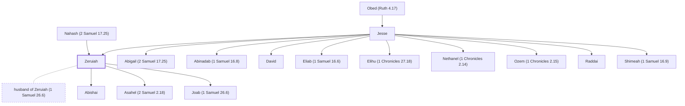

# Zeruiah

Sister of David; mother of Joab, Abishai, and Asahel

**Original-language names:** צְרוּיָה (H6870)

## When

- **Placed around:** [[connections/timeline/11th century BC|1027 BC]] *(Ussher: the median date of the passages naming them)*

## Family

- **Father:** [[connections/people/Jesse|Jesse]]
- **Mother:** [[connections/people/Nahash (2 Samuel 17.25)|Nahash (2 Samuel 17.25)]]
- **Brothers and sisters:** [[connections/people/Abigail (2 Samuel 17.25)|Abigail (2 Samuel 17.25) (uncertain)]], [[connections/people/Abinadab (1 Samuel 16.8)|Abinadab (1 Samuel 16.8)]], [[connections/people/David|David]], [[connections/people/Eliab (1 Samuel 16.6)|Eliab (1 Samuel 16.6)]], [[connections/people/Elihu (1 Chronicles 27.18)|Elihu (1 Chronicles 27.18)]], [[connections/people/Nethanel (1 Chronicles 2.14)|Nethanel (1 Chronicles 2.14)]], [[connections/people/Ozem (1 Chronicles 2.15)|Ozem (1 Chronicles 2.15)]], [[connections/people/Raddai|Raddai]], [[connections/people/Shimeah (1 Samuel 16.9)|Shimeah (1 Samuel 16.9)]]
- **Spouses:** [[connections/people/husband of Zeruiah (1 Samuel 26.6)|husband of Zeruiah (1 Samuel 26.6)]]
- **Children:** [[connections/people/Abishai|Abishai]], [[connections/people/Asahel (2 Samuel 2.18)|Asahel (2 Samuel 2.18)]], [[connections/people/Joab (1 Samuel 26.6)|Joab (1 Samuel 26.6)]]
- **Tribe or nation:** Tribe of Judah

**Line of descent** (34 generations, father to son): [[connections/people/Adam|Adam]] → [[connections/people/Seth|Seth]] → [[connections/people/Enosh|Enosh]] → [[connections/people/Kenan|Kenan]] → [[connections/people/Mahalalel (Genesis 5.12)|Mahalalel (Genesis 5.12)]] → [[connections/people/Jared|Jared]] → [[connections/people/Enoch (Genesis 5.18)|Enoch (Genesis 5.18)]] → [[connections/people/Methuselah|Methuselah]] → [[connections/people/Lamech (Genesis 5.25)|Lamech (Genesis 5.25)]] → [[connections/people/Noah (Genesis 5.29)|Noah (Genesis 5.29)]] → [[connections/people/Shem|Shem]] → [[connections/people/Arpachshad|Arpachshad]] → [[connections/people/Cainan|Cainan]] → [[connections/people/Shelah (Genesis 10.24)|Shelah (Genesis 10.24)]] → [[connections/people/Eber (Genesis 10.21)|Eber (Genesis 10.21)]] → [[connections/people/Peleg|Peleg]] → [[connections/people/Reu|Reu]] → [[connections/people/Serug|Serug]] → [[connections/people/Nahor (Genesis 11.22)|Nahor (Genesis 11.22)]] → [[connections/people/Terah|Terah]] → [[connections/people/Abraham|Abraham]] → [[connections/people/Isaac|Isaac]] → [[connections/people/Israel|Israel]] → [[connections/people/Judah (Genesis 29.35)|Judah (Genesis 29.35)]] → [[connections/people/Perez|Perez]] → [[connections/people/Hezron (Genesis 46.12)|Hezron (Genesis 46.12)]] → [[connections/people/Ram (Ruth 4.19)|Ram (Ruth 4.19)]] → [[connections/people/Amminadab (Exodus 6.23)|Amminadab (Exodus 6.23)]] → [[connections/people/Nahshon|Nahshon]] → [[connections/people/Salmon|Salmon]] → [[connections/people/Boaz|Boaz]] → [[connections/people/Obed (Ruth 4.17)|Obed (Ruth 4.17)]] → [[connections/people/Jesse|Jesse]] → **Zeruiah**

**Family group:** [[connections/genealogy/Family of Adam|Family of Adam]], generation 34

## Appears in

[[connections/chapters/09-1-samuel/1 Samuel 26|1 Samuel 26]] · [[connections/chapters/10-2-samuel/2 Samuel 2|2 Samuel 2 (2)]] · [[connections/chapters/10-2-samuel/2 Samuel 3|2 Samuel 3]] · [[connections/chapters/10-2-samuel/2 Samuel 8|2 Samuel 8]] · [[connections/chapters/10-2-samuel/2 Samuel 14|2 Samuel 14]] · [[connections/chapters/10-2-samuel/2 Samuel 16|2 Samuel 16 (2)]] · [[connections/chapters/10-2-samuel/2 Samuel 17|2 Samuel 17]] · [[connections/chapters/10-2-samuel/2 Samuel 18|2 Samuel 18]] · [[connections/chapters/10-2-samuel/2 Samuel 19|2 Samuel 19 (2)]] · [[connections/chapters/10-2-samuel/2 Samuel 21|2 Samuel 21]] · [[connections/chapters/10-2-samuel/2 Samuel 23|2 Samuel 23 (2)]] · [[connections/chapters/11-1-kings/1 Kings 1|1 Kings 1]] · [[connections/chapters/11-1-kings/1 Kings 2|1 Kings 2 (2)]] · [[connections/chapters/13-1-chronicles/1 Chronicles 2|1 Chronicles 2]] · [[connections/chapters/13-1-chronicles/1 Chronicles 11|1 Chronicles 11 (2)]] · [[connections/chapters/13-1-chronicles/1 Chronicles 18|1 Chronicles 18 (2)]] · [[connections/chapters/13-1-chronicles/1 Chronicles 26|1 Chronicles 26]] · [[connections/chapters/13-1-chronicles/1 Chronicles 27|1 Chronicles 27]]

## Appears in the same verse as

[[connections/people/Joab (1 Samuel 26.6)|Joab (1 Samuel 26.6) (18)]] · [[connections/people/Abishai|Abishai (9)]] · [[connections/people/David|David (8)]] · [[connections/people/Israel|Israel (4)]] · [[connections/people/Abiathar|Abiathar (2)]] · [[connections/people/Abigail (2 Samuel 17.25)|Abigail (2 Samuel 17.25) (2)]] · [[connections/people/Abner|Abner (2)]] · [[connections/people/Absalom|Absalom (2)]] · [[connections/people/Adonijah (2 Samuel 3.4)|Adonijah (2 Samuel 3.4) (2)]] · [[connections/people/Ahilud|Ahilud (2)]] · [[connections/people/Amasa (2 Samuel 17.25)|Amasa (2 Samuel 17.25) (2)]] · [[connections/people/Asahel (2 Samuel 2.18)|Asahel (2 Samuel 2.18) (2)]] · [[connections/people/Jehoshaphat (2 Samuel 8.16)|Jehoshaphat (2 Samuel 8.16) (2)]] · [[connections/people/Jether (2 Samuel 17.25)|Jether (2 Samuel 17.25) (2)]] · [[connections/people/Naharai|Naharai (2)]] · [[connections/people/Ner|Ner (2)]] · [[connections/people/Saul|Saul (2)]] · [[connections/people/Zelek|Zelek (2)]] · [[connections/people/Abishag|Abishag]] · [[connections/people/Ahimelech (1 Samuel 26.6)|Ahimelech (1 Samuel 26.6)]] · [[connections/people/Ittai (2 Samuel 15.19)|Ittai (2 Samuel 15.19)]] · [[connections/people/Kish (1 Samuel 9.1)|Kish (1 Samuel 9.1)]] · [[connections/people/Nahash (2 Samuel 17.25)|Nahash (2 Samuel 17.25)]] · [[connections/people/Samuel|Samuel]] · [[connections/people/Shelomoth (1 Chronicles 26.25)|Shelomoth (1 Chronicles 26.25)]] · [[connections/people/Shimei (2 Samuel 16.5)|Shimei (2 Samuel 16.5)]] · [[connections/people/Solomon|Solomon]] · [[connections/places/Beeroth|Beeroth]] · [[connections/places/Edom|Edom]] · [[connections/places/Gibeon|Gibeon]] · [[connections/places/Salt Valley|Salt Valley]]
