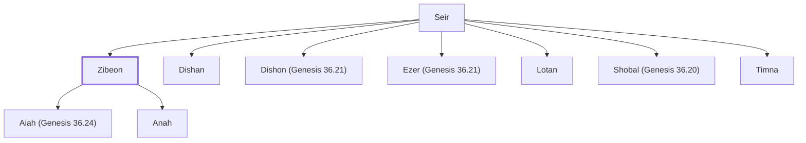

# Zibeon

Hivite grandfather of Esau's wife Oholibamah

**Original-language names:** צִבְעוֹן (H6649)

## When

- **Placed around:** [[connections/timeline/18th century BC|1712 BC]] *(Ussher: the median date of the passages naming them)*

## Family

- **Father:** [[connections/people/Seir|Seir]]
- **Brothers and sisters:** [[connections/people/Dishan|Dishan]], [[connections/people/Dishon (Genesis 36.21)|Dishon (Genesis 36.21)]], [[connections/people/Ezer (Genesis 36.21)|Ezer (Genesis 36.21)]], [[connections/people/Lotan|Lotan]], [[connections/people/Shobal (Genesis 36.20)|Shobal (Genesis 36.20)]], [[connections/people/Timna|Timna]]
- **Children:** [[connections/people/Aiah (Genesis 36.24)|Aiah (Genesis 36.24)]], [[connections/people/Anah|Anah]]
- **Tribe or nation:** Edom

**Family group:** [[connections/genealogy/Family of Adam|Family of Adam]], generation 2

## Appears in

[[connections/chapters/01-genesis/Genesis 36|Genesis 36 (2)]]

## Appears in the same verse as

[[connections/people/Anah|Anah (2)]] · [[connections/people/Esau|Esau (2)]] · [[connections/people/Oholibamah|Oholibamah (2)]] · [[connections/people/Adah (Genesis 26.34)|Adah (Genesis 26.34)]] · [[connections/people/Elon (Genesis 26.34)|Elon (Genesis 26.34)]] · [[connections/people/Jalam|Jalam]] · [[connections/people/Jeush (Genesis 36.5)|Jeush (Genesis 36.5)]] · [[connections/people/Korah (Genesis 36.5)|Korah (Genesis 36.5)]] · [[connections/places/Canaan|Canaan]]
