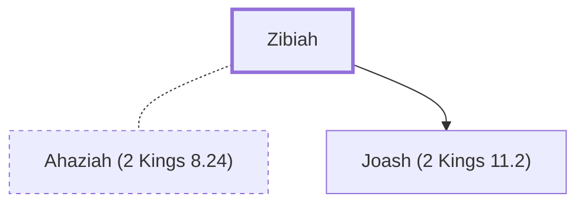

# Zibiah

Mother of King Joash (or 'Jehoash') of Judah from Beersheba

**Original-language names:** צִבְיָה (H6645)

## When

- **Placed around:** [[connections/timeline/9th century BC|878 BC]] *(Ussher: the median date of the passages naming them)*

## Family

- **Spouses:** [[connections/people/Ahaziah (2 Kings 8.24)|Ahaziah (2 Kings 8.24)]]
- **Children:** [[connections/people/Joash (2 Kings 11.2)|Joash (2 Kings 11.2)]]

**Family group:** [[connections/genealogy/Family of Adam|Family of Adam]], generation 44

## Appears in

[[connections/chapters/12-2-kings/2 Kings 12|2 Kings 12]] · [[connections/chapters/14-2-chronicles/2 Chronicles 24|2 Chronicles 24]]

## Appears in the same verse as

[[connections/people/Joash (2 Kings 11.2)|Joash (2 Kings 11.2) (2)]] · [[connections/places/Beersheba|Beersheba (2)]] · [[connections/places/Jerusalem|Jerusalem (2)]] · [[connections/people/Jehu (1 Kings 19.16)|Jehu (1 Kings 19.16)]]
