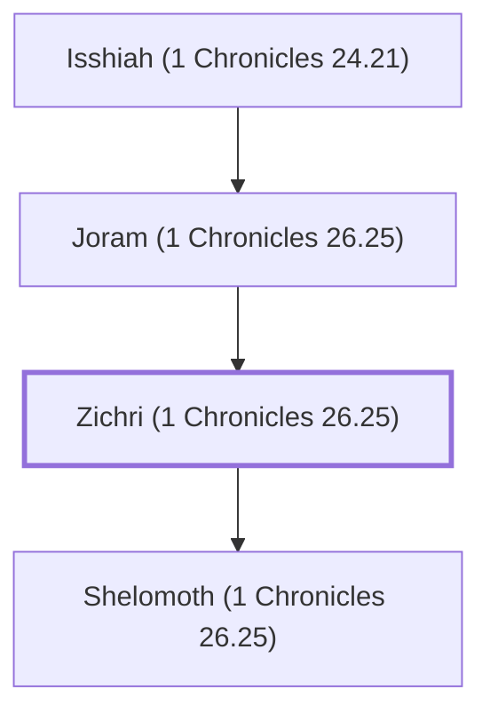

# Zichri (1 Chronicles 26.25)

Levite, descendant of Moses, treasurer

**Original-language names:** זִכְרִי (H2147)

## When

- **Placed around:** [[connections/timeline/11th century BC|1015 BC]] *(Ussher: the median date of the passages naming them)*

## Family

- **Father:** [[connections/people/Joram (1 Chronicles 26.25)|Joram (1 Chronicles 26.25)]]
- **Children:** [[connections/people/Shelomoth (1 Chronicles 26.25)|Shelomoth (1 Chronicles 26.25)]]
- **Tribe or nation:** Tribe of Levi

**Line of descent** (32 generations, father to son): [[connections/people/Adam|Adam]] → [[connections/people/Seth|Seth]] → [[connections/people/Enosh|Enosh]] → [[connections/people/Kenan|Kenan]] → [[connections/people/Mahalalel (Genesis 5.12)|Mahalalel (Genesis 5.12)]] → [[connections/people/Jared|Jared]] → [[connections/people/Enoch (Genesis 5.18)|Enoch (Genesis 5.18)]] → [[connections/people/Methuselah|Methuselah]] → [[connections/people/Lamech (Genesis 5.25)|Lamech (Genesis 5.25)]] → [[connections/people/Noah (Genesis 5.29)|Noah (Genesis 5.29)]] → [[connections/people/Shem|Shem]] → [[connections/people/Arpachshad|Arpachshad]] → [[connections/people/Cainan|Cainan]] → [[connections/people/Shelah (Genesis 10.24)|Shelah (Genesis 10.24)]] → [[connections/people/Eber (Genesis 10.21)|Eber (Genesis 10.21)]] → [[connections/people/Peleg|Peleg]] → [[connections/people/Reu|Reu]] → [[connections/people/Serug|Serug]] → [[connections/people/Nahor (Genesis 11.22)|Nahor (Genesis 11.22)]] → [[connections/people/Terah|Terah]] → [[connections/people/Abraham|Abraham]] → [[connections/people/Isaac|Isaac]] → [[connections/people/Israel|Israel]] → [[connections/people/Levi (Genesis 29.34)|Levi (Genesis 29.34)]] → [[connections/people/Kohath|Kohath]] → [[connections/people/Amram (Exodus 6.18)|Amram (Exodus 6.18)]] → [[connections/people/Moses|Moses]] → [[connections/people/Eliezer (Exodus 18.4)|Eliezer (Exodus 18.4)]] → [[connections/people/Rehabiah|Rehabiah]] → [[connections/people/Isshiah (1 Chronicles 24.21)|Isshiah (1 Chronicles 24.21)]] → [[connections/people/Joram (1 Chronicles 26.25)|Joram (1 Chronicles 26.25)]] → **Zichri (1 Chronicles 26.25)**

**Family group:** [[connections/genealogy/Family of Adam|Family of Adam]], generation 32

## Appears in

[[connections/chapters/13-1-chronicles/1 Chronicles 26|1 Chronicles 26]]

## Appears in the same verse as

[[connections/people/Eliezer (Exodus 18.4)|Eliezer (Exodus 18.4)]] · [[connections/people/Isshiah (1 Chronicles 24.21)|Isshiah (1 Chronicles 24.21)]] · [[connections/people/Joram (1 Chronicles 26.25)|Joram (1 Chronicles 26.25)]] · [[connections/people/Rehabiah|Rehabiah]] · [[connections/people/Shelomoth (1 Chronicles 26.25)|Shelomoth (1 Chronicles 26.25)]]
