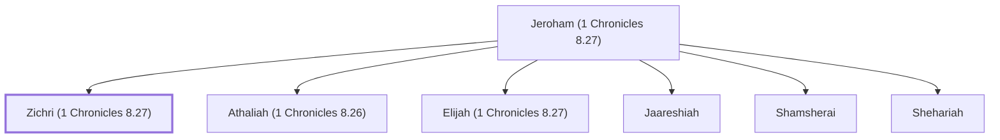

# Zichri (1 Chronicles 8.27)

Son of Jeroham, a Benjamite

**Original-language names:** זִכְרִי (H2147)

## Family

- **Father:** [[connections/people/Jeroham (1 Chronicles 8.27)|Jeroham (1 Chronicles 8.27)]]
- **Brothers and sisters:** [[connections/people/Athaliah (1 Chronicles 8.26)|Athaliah (1 Chronicles 8.26)]], [[connections/people/Elijah (1 Chronicles 8.27)|Elijah (1 Chronicles 8.27)]], [[connections/people/Jaareshiah|Jaareshiah]], [[connections/people/Shamsherai|Shamsherai]], [[connections/people/Shehariah|Shehariah]]
- **Tribe or nation:** Tribe of Benjamin

**Family group:** [[connections/genealogy/Family of Jeroham (1 Chronicles 8.27)|Family of Jeroham (1 Chronicles 8.27)]], generation 2

## Appears in

[[connections/chapters/13-1-chronicles/1 Chronicles 8|1 Chronicles 8]]

## Appears in the same verse as

[[connections/people/Elijah (1 Chronicles 8.27)|Elijah (1 Chronicles 8.27)]] · [[connections/people/Jaareshiah|Jaareshiah]] · [[connections/people/Jeroham (1 Chronicles 8.27)|Jeroham (1 Chronicles 8.27)]]
