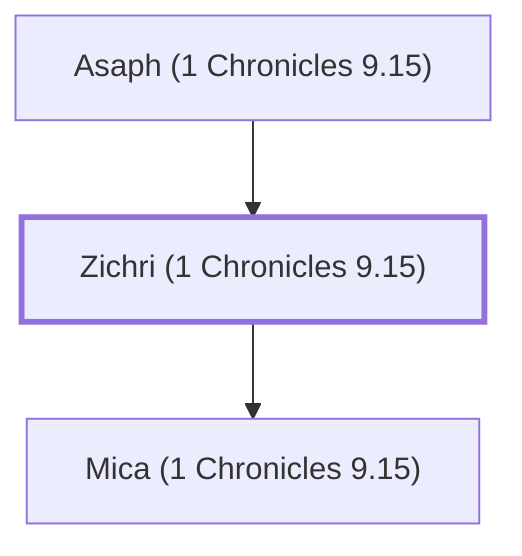

# Zichri (1 Chronicles 9.15)

Levite, descendant of Asaph, temple singer

**Also called:** Zabdi

**Original-language names:** זִכְרִי (H2147) · זַבְדִּי (H2067)

## When

- **Placed around:** [[connections/timeline/5th century BC|445 BC]] *(Ussher: the median date of the passages naming them)*

## Family

- **Father:** [[connections/people/Asaph (1 Chronicles 9.15)|Asaph (1 Chronicles 9.15)]]
- **Children:** [[connections/people/Mica (1 Chronicles 9.15)|Mica (1 Chronicles 9.15)]]
- **Tribe or nation:** Tribe of Levi

**Family group:** [[connections/genealogy/Family of Asaph (1 Chronicles 9.15)|Family of Asaph (1 Chronicles 9.15)]], generation 2

## Appears in

[[connections/chapters/13-1-chronicles/1 Chronicles 9|1 Chronicles 9]] · [[connections/chapters/16-nehemiah/Nehemiah 11|Nehemiah 11]]

## Appears in the same verse as

[[connections/people/Asaph (1 Chronicles 9.15)|Asaph (1 Chronicles 9.15) (2)]] · [[connections/people/Mattaniah (1 Chronicles 9.15)|Mattaniah (1 Chronicles 9.15) (2)]] · [[connections/people/Mica (1 Chronicles 9.15)|Mica (1 Chronicles 9.15) (2)]] · [[connections/people/Bakbakkar|Bakbakkar]] · [[connections/people/Bakbukiah|Bakbukiah]] · [[connections/people/Galal (1 Chronicles 9.15)|Galal (1 Chronicles 9.15)]] · [[connections/people/Galal (1 Chronicles 9.16)|Galal (1 Chronicles 9.16)]] · [[connections/people/Heresh|Heresh]] · [[connections/people/Jeduthun (1 Chronicles 9.16)|Jeduthun (1 Chronicles 9.16)]] · [[connections/people/Obadiah (1 Chronicles 9.16)|Obadiah (1 Chronicles 9.16)]] · [[connections/people/Shemaiah (1 Chronicles 9.16)|Shemaiah (1 Chronicles 9.16)]]
