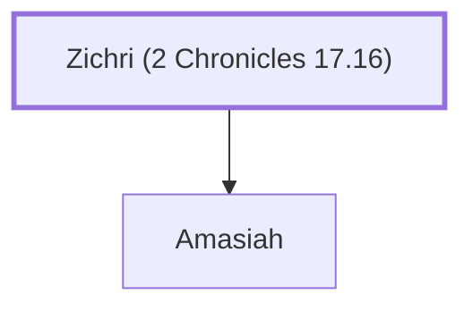

# Zichri (2 Chronicles 17.16)

Commander of 200,000 soldiers under Jehoshaphat

**Original-language names:** זִכְרִי (H2147)

## When

- **Placed around:** [[connections/timeline/10th century BC|912 BC]] *(Ussher: the median date of the passages naming them)*

## Family

- **Children:** [[connections/people/Amasiah|Amasiah]]

**Family group:** [[connections/genealogy/Family of Zichri (2 Chronicles 17.16)|Family of Zichri (2 Chronicles 17.16)]], generation 1

## Appears in

[[connections/chapters/14-2-chronicles/2 Chronicles 17|2 Chronicles 17]]

## Appears in the same verse as

[[connections/people/Amasiah|Amasiah]]
