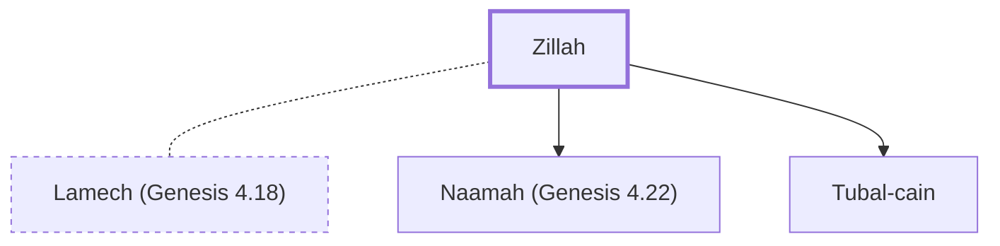

# Zillah

Wife of Lamech; mother of Tubal-Cain and Naamah

**Original-language names:** צִלָּה (H6741)

## When

- **Placed around:** [[connections/timeline/41st century BC|4003 BC]] *(Ussher: the median date of the passages naming them)*

## Family

- **Spouses:** [[connections/people/Lamech (Genesis 4.18)|Lamech (Genesis 4.18)]]
- **Children:** [[connections/people/Naamah (Genesis 4.22)|Naamah (Genesis 4.22)]], [[connections/people/Tubal-cain|Tubal-cain]]

**Family group:** [[connections/genealogy/Family of Adam|Family of Adam]], generation 7

## Appears in

[[connections/chapters/01-genesis/Genesis 4|Genesis 4 (3)]]

## Appears in the same verse as

[[connections/people/Adah (Genesis 4.19)|Adah (Genesis 4.19) (2)]] · [[connections/people/Lamech (Genesis 4.18)|Lamech (Genesis 4.18) (2)]] · [[connections/people/Naamah (Genesis 4.22)|Naamah (Genesis 4.22)]] · [[connections/people/Tubal-cain|Tubal-cain]]
