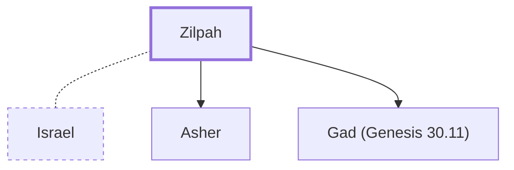

# Zilpah

Leah's maidservant; mother of Gad and Asher

**Original-language names:** זִלְפָּה (H2153)

## When

- **Placed around:** [[connections/timeline/18th century BC|1748 BC]] *(Ussher: the median date of the passages naming them)*

## Family

- **Spouses:** [[connections/people/Israel|Israel]]
- **Children:** [[connections/people/Asher|Asher]], [[connections/people/Gad (Genesis 30.11)|Gad (Genesis 30.11)]]

**Family group:** [[connections/genealogy/Family of Adam|Family of Adam]], generation 25

## Events

- [[connections/timeline/18th century BC|1753 BC]] · [[connections/events/Birth of Gad|Birth of Gad]]
- [[connections/timeline/18th century BC|1752 BC]] · [[connections/events/Birth of Asher|Birth of Asher]]

## Appears in

[[connections/chapters/01-genesis/Genesis 29|Genesis 29]] · [[connections/chapters/01-genesis/Genesis 30|Genesis 30 (3)]] · [[connections/chapters/01-genesis/Genesis 35|Genesis 35]] · [[connections/chapters/01-genesis/Genesis 37|Genesis 37]] · [[connections/chapters/01-genesis/Genesis 46|Genesis 46]]

## Appears in the same verse as

[[connections/people/Israel|Israel (6)]] · [[connections/people/Leah|Leah (6)]] · [[connections/people/Laban|Laban (2)]] · [[connections/people/Asher|Asher]] · [[connections/people/Bilhah|Bilhah]] · [[connections/people/Gad (Genesis 30.11)|Gad (Genesis 30.11)]] · [[connections/people/Joseph (Genesis 30.24)|Joseph (Genesis 30.24)]] · [[connections/places/Paddan|Paddan]]
